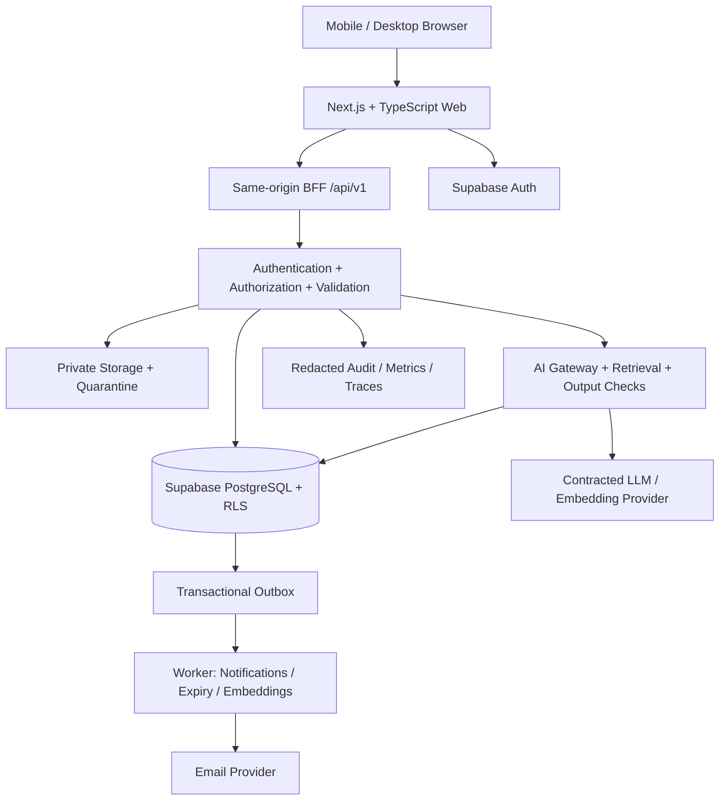
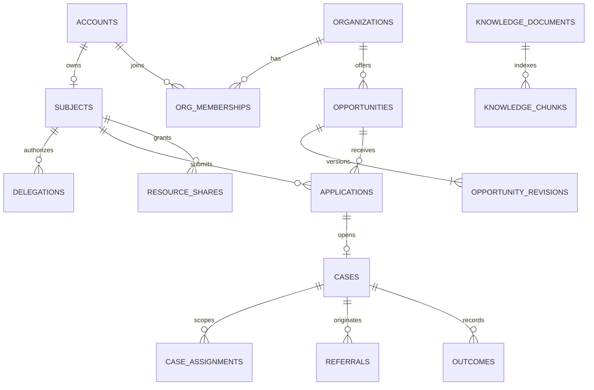

# Global Opportunity OS — Product Blueprint

**ฉบับส่งต่อทีมพัฒนา • ภาษาไทย • Version 1.0 • 4 พฤศจิกายน 2026 (Asia/Bangkok)**

สถานะเอกสาร: **Development-ready proposal** สำหรับวางแผน ประเมินงาน และสร้างต้นแบบ ไม่ใช่หลักฐานว่ารายละเอียดทุกข้อได้รับอนุมัติหรือผ่านการตรวจทางกฎหมายแล้ว

เจ้าของผลิตภัณฑ์: ผู้ก่อตั้งโครงการ (Product Owner; PO) • ผู้รับเอกสาร: Product, Design, Engineering, QA, Partner Operations, Privacy และ Safeguarding

## สารบัญ

1. หลักฐานและสถานะข้อกำหนด
2. วิสัยทัศน์ ขอบเขต และโมเดลรายได้
3. สมมติฐานสถาปัตยกรรมและการตัดสินใจ
4. User Roles, RBAC และการมอบอำนาจ
5. Modules และ Feature Priorities
6. User Journeys และ State Machines
7. PostgreSQL/Supabase Data Model
8. RLS, Storage และ Tenant Isolation
9. AI Navigator, RAG และ Matching
10. Privacy, Security และ Minor Safeguarding
11. Accessibility และ UX
12. Admin, NGO, Employer และ CSR Dashboards
13. API Contracts และ Integrations
14. Nonfunctional Requirements และ Operations
15. Impact Metrics และ Business Metrics
16. Acceptance Criteria และ Testing
17. Phased MVP Sprint Backlog
18. Release Gates, Handover และ Repository Structure
19. Decision Register และความเสี่ยง
20. แหล่งอ้างอิงและอภิธานศัพท์

## 1. หลักฐานและสถานะข้อกำหนด

### 1.1 แหล่งบริบทที่ใช้

อ่านแชต **“วิเคราะห์เว็บแอปเพื่อสังคม”** ID `6ae9ea20-9d70-83ec-a55d-036b537dbb2c` ผ่านเครื่องมือ read_thread โดยได้รับ 5 turns และไม่มีหน้าถัดไป รวมทั้งข้อความคำขอปัจจุบัน โฟลเดอร์ทำงานเริ่มต้นไม่มีเอกสารหรือโค้ดให้ใช้ยืนยัน implementation จึงไม่อ้างว่าได้ตรวจ repository บน GitHub หรือระบบที่ deploy แล้ว

ข้อความผู้ช่วยเดิมเป็นบริบทและข้อเสนอ ไม่ใช่การอนุมัติจากผู้ใช้ ข้อความเดิมที่บอกว่าได้ส่งงานไป Work ไม่ใช่หลักฐานว่ามีเอกสาร Starter Pack อยู่จริง ไม่ได้นำสถิติตลาดและประมาณการรายได้เดิมมาใช้เป็นข้อเท็จจริงในข้อกำหนดระบบ

### 1.2 นิยามสถานะ

| รหัส | ความหมาย | การใช้โดยทีมพัฒนา |
|---|---|---|
| A — Approved direction | ผู้ใช้ระบุชัดในแชตหรือคำขอปัจจุบัน | ใช้กำหนดทิศทางผลิตภัณฑ์ได้ |
| P — Proposed requirement | รายละเอียดที่เอกสารนี้เสนอให้ทำ | ใช้สร้าง backlog/ต้นแบบได้ ต้องบันทึกการรับรองก่อน production |
| D — Decision required | ตัวเลือกที่ส่งผลต่อ scope, risk, contract หรืองบประมาณ | ระบุ owner และ gate ที่ต้องตัดสินใจ ไม่เลือกเงียบ ๆ |
| F — Future | อยู่นอก MVP | ไม่ทำให้เป็น dependency ของ MVP |

**กติกาทั้งฉบับ:** ยกเว้นรายการ A ด้านล่าง รายละเอียดเชิงปฏิบัติ ตัวเลข SLA ราคา สูตรคะแนน ระยะเวลา retention และ backlog ทั้งหมดเป็น **P** แม้ใช้คำว่า “ต้อง” เพื่อเขียนให้ทดสอบได้ การอนุมัติเอกสารในอนาคตต้องอ้าง version และรายการที่ยอมรับ ไม่เปลี่ยน P เป็น A ย้อนหลังโดยไม่มีหลักฐาน

### 1.3 สิ่งที่ยืนยันจากผู้ใช้

| ID | ข้อกำหนดที่ยืนยัน | หลักฐาน |
|---|---|---|
| A-01 | Web app ช่วยผู้ยากไร้และผู้ด้อยโอกาสทั่วโลก พร้อมรายได้ที่ทำให้ผู้ก่อตั้งและระบบเติบโต | คำขอเริ่มต้นในแชตเดิม |
| A-02 | กลุ่มเป้าหมายครอบคลุม “D ทุกกลุ่ม” | คำตอบผู้ใช้ในแชตเดิม |
| A-03 | ต้องมีบริบทโครงการและโครงสร้างที่ส่งต่อพัฒนาได้; ผู้ใช้แจ้งว่าสร้าง repository และเชื่อม GitHub แล้ว | คำขอ Starter Pack ในแชตเดิม; ยังไม่ได้ตรวจการเชื่อมจริง |
| A-04 | ต้องการ Product Blueprint ละเอียด รวม roles, features, journeys, schema, AI, security, dashboards และ MVP | คำขอสุดท้ายเดิมและคำขอปัจจุบัน |
| A-05 | ใช้ relational PostgreSQL/Supabase เป็นฐานออกแบบในเอกสารนี้ รวม RLS, API, tests และ sprint dependencies | คำขอปัจจุบัน; ไม่เท่ากับเลือก region/plan/vendor contract แล้ว |
| A-06 | เอกสารภาษาไทย ใช้ English technical terms ได้ ส่งเป็น Markdown แก้ไขได้; DOCX เป็นทางเลือก | คำขอปัจจุบัน |

### 1.4 แก้ความขัดกันของข้อเสนอเดิม

ข้อเสนอแรกเน้น Job & Income Matching แต่หลังผู้ใช้เลือกทุกกลุ่ม ผู้ช่วยเสนอแพลตฟอร์มหลายบริการและ verified referral workflows เอกสารนี้ใช้ **core platform + verified opportunity/referral + งานสำหรับผู้ใหญ่หนึ่ง vertical** เป็น P สำหรับ MVP ไม่ถือว่า user เลือกเปิด marketplace เต็มรูปแบบแล้ว การให้บริการทุกกลุ่มเป็นวิสัยทัศน์ระยะยาว ไม่ใช่การเปิดทุกกลุ่มใน pilot วันแรก

## 2. วิสัยทัศน์ ขอบเขต และโมเดลรายได้

### 2.1 Product promise

**Global Opportunity OS: One Platform. Equal Access to Opportunity.** ช่วยให้คนค้นพบโอกาสจริง เข้าใจเงื่อนไข ลงมือสมัครหรือขอส่งต่อ และติดตามว่าได้รับผลลัพธ์หรือไม่ โดยเครือข่ายองค์กรที่ตรวจสอบแล้ว AI ช่วยค้นหา อธิบาย และเตรียมข้อมูล; คนและองค์กรที่รับผิดชอบเป็นผู้ตัดสินใจเรื่องการรับบริการ/จ้างงาน

วงจรหลัก: **Understand → Discover → Action → Connect → Verify Impact** เป้าหมายไม่จบที่ chatbot หรือจำนวนผู้สมัคร ต้องติดตามการได้รับบริการและการแก้ปัญหาที่ตรวจสอบได้

### 2.2 กลุ่มผู้ใช้และความต้องการ

| กลุ่ม | ปัญหา/Jobs to be done | ผลิตภัณฑ์ควรรองรับ |
|---|---|---|
| ผู้รายได้น้อย ว่างงาน แรงงานนอกระบบ | หาโอกาสที่ไว้ใจได้และไม่เสียค่าสมัครล่วงหน้า | งาน/ฝึกทักษะ/ส่งต่อ, ค่าตอบแทนและค่าใช้จ่ายชัดเจน |
| คนพิการ ผู้สูงอายุ ผู้ดูแล ครอบครัวเลี้ยงเดี่ยว | ข้อจำกัดเวลา การเดินทาง การเข้าถึงเครื่องมือ | accommodation, remote/เวลา, assisted access |
| เด็กและเยาวชน | การศึกษา ทักษะ ความปลอดภัย | เส้นทางที่ดูแลโดยองค์กร; gate แยกจาก adult pilot |
| ผู้ประกอบการรายย่อย | ทักษะ การเข้าถึงตลาด | directory/อบรมใน MVP; commerce ระยะหลัง |
| NGO/ชุมชน/ผู้ให้บริการ | รับคำขอซ้ำ ข้อมูลกระจัดกระจาย | case queue, consent, referral, outcome |
| นายจ้าง | ผู้สมัครที่เหมาะสม กระบวนการที่เป็นธรรม | verified jobs, scoped applications, human review |
| CSR/Sponsor | ใช้งบและแสดงผลจริงโดยรักษาความเป็นส่วนตัว | program dashboard และ aggregated impact |

### 2.3 MVP boundary ที่เสนอ

Pilot ในประเทศไทย ภาษาไทยเป็นหลักและโครงสร้างรองรับ English เริ่มผู้ใหญ่ 18+ ที่ลงทะเบียนเองหรือมีผู้ช่วยที่ได้รับมอบอำนาจ เน้น verified assistance/training referrals และงานผู้ใหญ่ที่ผ่านการตรวจสอบ ไม่รับข้อมูลเคสเด็กใน production จนผ่าน D-03; เด็กยังอ่าน directory สาธารณะที่เหมาะสมได้โดยไม่สร้าง profile ส่วนตัว

MVP รวม account/profile, needs assessment, directory/filter, rule-based matching, bounded AI Navigator, bookmarks, application/referral, partner verification, case assignment, consent, notifications, complaints, outcome verification, dashboard และ audit

นอก MVP: wallet/escrow/payment processing, สินเชื่อ, การระดมบริจาคข้ามประเทศ, diagnosis/medical records, การตัดสินสิทธิหรือรับเข้าทำงานอัตโนมัติ, open chat/DM, public beneficiary profiles, social feed, full LMS, commerce checkout, native app, fully offline case editing และการเปิดหลายประเทศพร้อมกัน

### 2.4 Revenue design ที่เสนอ

บริการพื้นฐานสำหรับผู้รับประโยชน์ฟรี ไม่เก็บค่าสมัครงานล่วงหน้า ไม่ขายข้อมูลความเปราะบาง ไม่ให้การซื้อโฆษณาเปลี่ยน eligibility หรือคะแนนความเหมาะสม

| ช่องทาง | ผู้จ่าย/คุณค่าที่ซื้อ | MVP implementation |
|---|---|---|
| Partner SaaS | NGO/องค์กร ซื้อ workflow และรายงาน | entitlement per organization; ทำสัญญา/ใบแจ้งหนี้นอกแอป |
| Employer services | นายจ้าง ซื้อ workflow/support | pilot agreement; ยังไม่มี automated fee collection |
| Sponsored programs | CSR ซื้อการดำเนินโครงการและรายงานรวม | program scope + budget metadata; ไม่ถือเงินบริจาค |
| Marketplace commission | ธุรกรรมในอนาคต | F; ต้องมี legal/payment/dispute design แยก |

ไม่มีราคาที่อนุมัติในปัจจุบัน ตัวเลขราคาเดิมเป็นสมมติฐานทดลองตลาด การหาผู้จ่ายเงินจริงและ gross margin เป็นงาน product discovery คู่ขนานกับ engineering

## 3. สมมติฐานสถาปัตยกรรมและการตัดสินใจ

### 3.1 Reference architecture (P)



ใช้ modular monolith แยก modules ใน codebase เดียว ไม่เริ่มด้วย microservices: identity, partners, catalog, applications, cases, safeguarding, AI, impact และ operations ใช้ Supabase Auth/Database/Storage; BFF เป็นเจ้าของ business mutations ไม่มี business logic สำคัญอยู่เฉพาะ client

### 3.2 Technical assumptions

| หัวข้อ | Reference choice | เหตุผล/ข้อจำกัด |
|---|---|---|
| Frontend | Next.js, TypeScript, Tailwind, responsive web | version pin ตอน Sprint 0; ไม่ถือว่า framework version ล่าสุดเหมาะเสมอ |
| Backend | Next.js server routes/BFF, PostgreSQL transactions | Edge Functions เป็นทางเลือก worker adapter ไม่ซ้ำ business rules |
| Hosting | Vercel หรือ Netlify ยัง D-02 | ทดสอบ SSR, cron/worker runtime, region และต้นทุนก่อนเลือก |
| Database | Managed Supabase PostgreSQL; version ที่ผู้ให้บริการรองรับ | เลือก project/region/PITR plan ใน D-02 |
| Search | structured filters + normalized keyword; pgvector เพิ่มเมื่อ AI พร้อม | ไทยต้องทดสอบ segmentation; ไม่สมมติ English stemming ใช้กับไทยได้ |
| AI | vendor-neutral adapter, server-only; model/embedding pin ใน config | embedding dimension D กำหนดจากโมเดลที่เลือก และเปลี่ยนด้วย index version |
| Notifications | in-app + email MVP | SMS/LINE F; ไม่ใช้ notification แทน case record |
| Time/money | timestamptz UTC; render timezone per user/org; numeric + ISO currency | deadline มี timezone และเวลาปิดชัด; ไม่เก็บเงิน float |
| Localization | locale `th-TH`, `en`; country ISO 3166-1 alpha-2 | copy ผ่านคนตรวจ; policy/service ต้องระบุ country applicability |

### 3.3 Security execution model

Browser ใช้ publishable key สำหรับ Auth เท่านั้น ส่วน business API เรียก BFF; ปิด grant direct DML ของตาราง workflow แก่ anon/authenticated ใช้ user-context database RPC (`SECURITY INVOKER`) สำหรับ reads ที่ให้ RLS บังคับได้ และ mutation routines แบบจำกัดที่ตรวจ actor/current grants ทุกครั้ง

Mutations ที่ต้องใช้ privilege ข้ามตารางให้ใช้ **private schema function + least-privilege backend role** ผ่าน pooled server connection โดย BFF validate JWT แล้ว `SET LOCAL` actor claims ภายใน transaction จากค่าที่ตรวจแล้วเท่านั้น ฟังก์ชันไม่เชื่อ actor_id จาก request body และตรวจ permission ซ้ำใน DB ห้ามให้ user เรียก private privileged routine ผ่าน Data API ห้ามใช้ service_role เป็น default สำหรับ request ของผู้ใช้ หาก platform tooling บังคับใช้ service key ใน background job ต้อง scope operation แยกและมี audit

รายละเอียด connection/JWT claim propagation ต้องทำ integration spike Sprint 0 และ ADR; หากทำไม่ได้ให้เลือก user-JWT RPC exposed wrapper ที่ตรวจ actor ภายในครบถ้วน ไม่ fallback เป็น unrestricted service_role CRUD

## 4. User Roles, RBAC และการมอบอำนาจ

### 4.1 Principal model

`auth.users` = ผู้เข้าสู่ระบบ; `subjects` = บุคคลผู้รับประโยชน์; หนึ่ง subject ผูกบัญชีได้ศูนย์หรือหนึ่งบัญชี ผู้ช่วยมีบัญชีของตนเองและได้รับ scoped delegation ไปยัง subject จึงไม่ต้องแบ่ง password ผู้ใช้หนึ่งบัญชีเป็น beneficiary และสมาชิกหลายองค์กรได้ แต่ทุก request เลือก organization context ชัดเจน

สิทธิ์ = **role ∩ resource scope ∩ current state ∩ consent/share grant ∩ assurance level** UI ที่ซ่อนปุ่มไม่ใช่ authorization ใช้ active membership จาก DB ไม่ใช้ user-editable metadata และไม่ยึด JWT role cache สำหรับการถอนสิทธิ์เร่งด่วน

### 4.2 Roles

| Role | ขอบเขต | สิ่งที่ทำได้ | สิ่งที่ไม่ได้โดยอัตโนมัติ |
|---|---|---|---|
| Guest | public | อ่าน published safe directory, report listing | อ่าน profile/เคส/ผู้สมัคร |
| Beneficiary | subject ตนเอง | profile, needs, saved items, submit/withdraw, outcome, consent, complaint | แก้ verified status/ผลพิจารณา |
| Assisted delegate / Guardian | subject + granted scopes + expiry | prepare/submit ตาม scope, ดู progress ตามสิทธิ์ | รับสิทธิ์จากการบอกว่าเป็นญาติ; ดูทุกข้อมูล |
| Org owner | organization | จัดการสมาชิก/ตั้งค่า/ส่งตรวจองค์กร | เห็น sensitive notes ทุกเคส หรือ approve องค์กรตัวเอง |
| Org admin | organization | members ที่ไม่ใช่ owner, queue routing, draft catalog | platform role หรือ cross-tenant access |
| Catalog editor | organization | create/edit draft, submit publication | publish เอง/ดูผู้สมัครทั้งหมด |
| Caseworker | organization + assigned case | triage, referral, notes, outcome evidence ตาม grant | browse beneficiary pool |
| Case supervisor | organization + queue | assign/reassign, review closure | health/disability details ที่ไม่ได้แชร์ |
| Employer recruiter | organization + owned opportunity applications | ดู application package, human decision, job outcome | ดู poverty/medical/NGO case history |
| CSR analyst | sponsor program aggregate | ดู suppressed aggregate, download aggregate report | identifiable beneficiary, raw application export |
| Partner verifier | verification queue | เอกสารองค์กรและตรวจรับรอง | เปิด case files ผู้รับประโยชน์ |
| Content moderator | catalog/report queue | review/publish/suspend listing | อ่าน private chat/profile ทั้งหมด |
| Safeguarding officer | assigned safeguarding incident | safety review + scoped evidence + escalation | เข้าถึงทุกคนแบบถาวร |
| Support agent | account support | masked account diagnostics, assist recovery | impersonate/เปิด transcript โดยปริยาย |
| Privacy officer | assigned privacy requests | export/delete workflow + legal hold review | แก้ผลคัดเลือกผู้สมัคร |
| Platform admin | platform configuration | manage platform roles, feature flags, operational controls | unrestricted PII; break-glass ยังต้องมีเหตุผล |
| Background worker | explicit machine scope | expiry/index/notification jobs | login interactive / ปลอม actor |

Org role ใช้หลายรายการได้ต่อ membership (เช่น owner+catalog_editor); platform role อยู่คนละตาราง ไม่อนุมานสิทธิ์จาก `organization.type` เพียงอย่างเดียว NGO สามารถเป็น employer ได้เมื่อได้รับ capability ที่ผ่านตรวจแล้ว

### 4.3 Permission matrix

สัญลักษณ์: O = own, A = assigned + active share, T = tenant resource, Q = queue scope, G = aggregate, — = deny

| Resource/action | Beneficiary | Delegate | Caseworker | Recruiter | Org admin | CSR | Platform ops |
|---|---|---|---|---|---|---|---|
| แก้ profile | O | scope | — | — | — | — | — |
| อ่าน application | O | scope | A | T เฉพาะ job package | routing metadata | — | Q เฉพาะ incident |
| ตัดสิน application | — | — | A service | T job | ต้องมี supervisor role | — | — |
| เขียน case internal note | — | — | A | — | ต้องมี case role | — | — |
| อ่าน beneficiary-visible notes | O | scope | A | — | — | — | incident grant |
| publish listing | — | — | — | — | submit ได้ | — | moderator Q |
| เชิญ org member | — | — | — | — | T | — | verifier ไม่ได้ |
| outcome verification | ยืนยันได้รับ | scope | ส่ง evidence | ส่ง job evidence | role เพิ่ม | — | reviewer scope |
| export raw PII | own privacy request | scope + verification | — default | — default | — default | — | privacy workflow |
| impact report | own history | scope | T allowed aggregate | T aggregate | T aggregate | G program | G platform |

### 4.4 Delegation and access lifecycle

Self-user อนุมัติ invitation หลังยืนยันตัวตน ระบุ `profile:read`, `profile:write`, `application:prepare`, `application:submit`, `progress:read` แยกกัน อายุสิทธิ์เสนอ 90 วัน; คนที่ไม่มี account ใช้ assisted registration ที่เจ้าหน้าที่ที่ผ่านฝึกอบรมตรวจความยินยอมและบันทึกวิธีตรวจ (ไม่สร้าง account ปลอม) ต้องมีช่องทาง revoke ผ่านเจ้าหน้าที่อื่นและ audit

Guardian ของผู้เยาว์ต้องผ่านกระบวนการพิสูจน์อำนาจ ไม่ใช่ checkbox; authority, jurisdiction และ expiry แยกจาก consent ของเด็ก เปิดใช้งานหลัง gate เด็กเท่านั้น

เมื่อ member ถูกระงับ/subject ถอน share ต้อง deny request ถัดไปจาก DB ทันที ยกเลิก queued export/notification payload ที่ยังไม่ส่ง Reassignment ถอนสิทธิ์คนเดิม ยกเว้นมี explicit handover access ที่จำกัดเวลา การเปิดไฟล์ signed URL ที่ออกไปแล้วอาจยังใช้ได้จนหมดอายุ จึงใช้ proxy read สำหรับไฟล์ที่ต้องถอนทันที

Break-glass: MFA + incident_id + reason + approver อีกคน + scope/expiry สูงสุด 1 ชั่วโมง; มี read audit และ post-review ภายในวันทำการถัดไป ไม่เปิดให้ support ใช้โดยปริยาย

## 5. Modules และ Feature Priorities

P0 = ขาดแล้วไม่เปิด pilot; P1 = หลัง core loop ผ่านและก่อน scale; P2 = future experiment

| ID | Module/feature | Priority | รายละเอียด/กฎธุรกิจ | Dependency |
|---|---|---|---|---|
| ID-01 | Auth/recovery | P0 | verified email, session expiry, staff MFA, accessible recovery | region/provider |
| ID-02 | Profile/assisted access | P0 | minimal profile, delegation scopes, safe contact preference | ID-01, consent |
| NA-01 | Needs assessment | P0 | goals, skill/time/location/language; skip sensitive questions | ID-02 |
| OR-01 | Organization verification | P0 | legal/contact/domain/manual check, evidence expiry, suspend | staff roles |
| DI-01 | Verified directory | P0 | search/filter/detail, source/date, capacity, eligibility, no fee scam | OR-01 |
| DI-02 | Catalog lifecycle | P0 | versioned draft/review/publish/expiry; material edits re-review | DI-01 |
| MA-01 | Deterministic matching | P0 | hard filters + explainable score + unknown eligibility | NA-01, DI-01 |
| AI-01 | AI Navigator bounded RAG | P0 | citations, no autonomous submit, fallback search/handoff | DI-01, MA-01, AI safety eval |
| AP-01 | Applications/referrals | P0 | review payload, explicit consent, idempotent submit, withdraw | OR-01, shares |
| CM-01 | Case management | P0 | assignment, status, notes visibility, due dates, warm referral | AP-01 |
| OC-01 | Outcome verification | P0 | self report vs partner evidence vs independently verified | CM-01 |
| SF-01 | Complaints/safeguarding | P0 | report, block, escalation, appeal; separate incident ACL | ID-01, operations |
| NO-01 | Notifications | P0 | generic in-app/email, opt-out nonessential, no sensitive subject | outbox |
| DA-01 | Admin/partner dashboard | P0 | operational queue, stale listings, role and audit | workflow tables |
| IM-01 | Aggregate impact/CSR | P0 basic | program totals with suppression; provenance/export | OC-01 |
| PR-01 | Privacy rights/retention | P0 | request intake, export/delete, holds, purge jobs | all PII stores |
| AC-01 | Accessibility/low bandwidth | P0 | keyboard, screen reader, mobile, plain Thai | design system |
| JB-01 | Adult job workflow | P0 narrow | compensation/contract type, verified employer, no upfront fee | DI-01, AP-01 |
| ED-01 | Education links/pathways | P0 directory; P1 tracking | curated provider links; no full course engine | DI-01 |
| MN-01 | Minor assisted cases | P1 gated | verified guardian, trained staff, safe education referrals | D-03, SF-01 |
| BI-01 | Billing/entitlements | P1 | paid org plans; manual contract pilot | D-06 |
| IN-01 | LINE/SMS/provider API | P1 | verified callbacks and opt-in | NO-01, contracts |
| GL-01 | Country expansion | P2 | country policy pack, local partner operations | local legal/privacy gate |
| CO-01 | Marketplace/payments | P2 | separate product risk design | payment/legal/disputes |

ทุก listing ต้องมีผู้รับผิดชอบและช่องทางรายงาน ไม่มีผล “ไม่เข้าเกณฑ์” จาก AI เป็น final denial; ผู้ใช้เปิดดูทั้งหมดและติดต่อเจ้าหน้าที่ได้

## 6. User Journeys และ State Machines

### 6.1 Journey J1 — สมัครเองจนได้รับบริการ

1. Guest เลือกภาษา/ค้นหาโอกาสก่อนสร้างบัญชี เห็น provider, วันที่ตรวจล่าสุด, deadline, ค่าใช้จ่าย และข้อจำกัด
2. สมัคร/ยืนยัน email อ่าน notice แบบสั้น เลือก safe contact ไม่บังคับยินยอม marketing หรือ AI เพื่อใช้ directory
3. สร้าง subject/profile ขั้นต่ำ ระบุประเทศ/จังหวัด เป้าหมาย ทักษะ เวลา เลือกข้ามข้อมูล sensitive ได้
4. กรอก needs หรือสนทนา Navigator; AI เสนอสิ่งที่เข้าใจ ผู้ใช้ตรวจและกดยืนยันก่อนบันทึก structured assessment
5. ระบบแสดง matched opportunities พร้อมเหตุผล unknown criteria และทางเลือกค้นหาเอง ไม่เผยข้อมูลไปยัง partner ระหว่างค้นหา
6. เปิดรายละเอียด เลือกสมัคร เห็น snapshot package ว่าจะส่งอะไร ให้ใคร เพื่ออะไร และ policy version เลือก consent/share เฉพาะคำขอนี้
7. BFF recheck active listing, provider, deadline, capacity, current actor grant แล้วสร้าง application + submission snapshot + share grant + event + outbox ใน transaction เดียว คืน receipt
8. Partner triage ขอข้อมูลเพิ่มผ่านระบบแบบ structured ผู้ใช้ส่งเท่าที่จำเป็น ถ้าไม่มีความคืบหน้าตาม SLA ระบบแจ้ง supervisor; ไม่อ้างว่ารับบริการแล้ว
9. Partner accept/schedule/record delivered ผู้ใช้ยืนยันหรือโต้แย้ง outcome; verified metric นับเมื่อผ่าน rule ใน §15
10. ผู้ใช้เห็นประวัติ ดาวน์โหลดข้อมูลตนเอง ถอน future sharing หรือยื่น complaint ได้

Exception: AI ล่มใช้ search; listing หมดอายุที่ submit คืน 409 พร้อมทางเลือก; email ซ้ำไม่เผยว่าบัญชีมีอยู่; เน็ตหลุด retry idempotency key เดิม; ไม่มีโอกาสตรงแสดง no-match และ human referral queue โดยไม่สร้างโอกาสปลอม

### 6.2 J2 — Assisted user

เจ้าหน้าที่เข้าสู่บัญชีตัวเอง → สร้าง assisted subject หลังตรวจ identity/consent ตาม SOP → บันทึก delegation และหลักฐานวิธีตรวจ → เลือก subject ชัดทุกหน้าป้องกันกรอกผิดคน → เตรียม application → read-back ภาษาเข้าใจง่าย → บันทึก confirmation event/consent ก่อน submit → ผู้รับประโยชน์รับ receipt ทาง safe contact หรือกระดาษที่ไม่เผยข้อมูล sensitive → เจ้าหน้าที่อื่นช่วย revoke/transfer ownership เมื่อผู้ใช้มีบัญชีเอง

กรณีรับโอน subject ไปบัญชีใหม่ต้องพิสูจน์คนเดียวกันโดยมนุษย์ ใช้ transaction และ audit ไม่ merge อัตโนมัติด้วยชื่อ/เบอร์โทร; ผู้ช่วยเปลี่ยนเจ้าของ subject ไม่ได้เอง

### 6.3 J3 — Partner onboarding/catalog

สมัครองค์กร → contact verified → upload เอกสารเข้าพื้นที่ quarantine → verifier ตรวจนิติบุคคล/ผู้ติดต่อ/บริการ/ความปลอดภัย → request corrections หรือ verify พร้อม expiry → org owner เชิญทีมด้วย least privilege → editor สร้าง listing → moderator ตรวจ fee/scam/eligibility/content → publish version ที่อนุมัติ → expiry job ปิด listing อัตโนมัติ → revalidation และ publish version ใหม่

Verification badge บอกขอบเขต/วันที่ตรวจ ไม่รับประกันคุณภาพบริการตลอดไป Suspend organization หยุด publish/new applications ทันที แต่ให้ทีม operations ประสานเคสค้างอย่างปลอดภัย ไม่ลบประวัติ

### 6.4 J4 — NGO warm referral

ผู้ใช้ยินยอมสร้าง case กับ NGO A → supervisor assign caseworker → triage และแผนงาน → caseworker พบว่า B เหมาะกว่า → เสนอ referral ให้ผู้ใช้เห็น recipient B และ exact fields → confirm share → สร้าง referral pending → B รับ/ปฏิเสธ → เมื่อรับจึงเปิด destination case เฉพาะ package ที่แชร์ → A เห็นเพียงสถานะส่งต่อที่ตกลงไว้ ไม่เห็น internal notes ของ B → ติดตามผล/ปิดเคสตามเหตุผล

Consent ปฏิเสธไม่ปิด case ของ A อัตโนมัติ Referral ถูกถอนก่อน B รับต้องปิดสิทธิ์ B และแจ้ง cancellation ไม่มี cross-org access ผ่าน case_id อย่างเดียว

### 6.5 J5 — Adult employment

Verified employer ลงงานที่ระบุ compensation range/currency/unit, hours, location, contract type และข้อกำหนด → moderator ตรวจ → ผู้ใหญ่สมัครด้วย skills/contact package ที่เลือกแชร์ → recruiter review ด้วยมนุษย์ → interview/offer/decline พร้อม reason → ผู้ใช้ accept offer → บันทึก started/completed และ payment self-report/evidence แยก → outcome reviewer ยืนยันตาม evidence rule

ระบบไม่จ่าย/ถือเงินเอง งาน unpaid volunteer ต้องเป็นชนิดแยกและแสดงชัด ไม่แสดงเป็น paid job การไม่จ่ายค่าจ้างเป็น complaint ที่ต้องมีเจ้าหน้าที่ดูแล ไม่แก้เป็น “completed” เพื่อเพิ่ม KPI

### 6.6 J6 — CSR program

Sponsor + partner ตั้ง program และ intended outcomes → อนุมัติขอบเขตข้อมูล/การวัด → ผูกโอกาสกับ program → partner ทำ case workflows → ระบบรวม outcome ที่มี provenance → sponsor เห็น suppressed aggregates ตาม cohort/time window ที่กำหนด → export มีวันที่/metric version/limitations; ไม่มี drill-down ไป PII และไม่มีรายงานเรื่องราวผู้ใช้หากไม่ได้ consent แยก

### 6.7 J7 — Report, appeal และ privacy request

ผู้ใช้รายงาน listing/เจ้าหน้าที่/ผลตัดสิน → receipt และ safe follow-up → triage severity → limited incident access → contain (hide listing/revoke member) → reviewer ที่ไม่ใช่ผู้ตัดสินเดิมพิจารณา → แจ้งผลและช่องทาง appeal → close พร้อม audit

Privacy request แยก workflow: verify requester → scope stores/subprocessors/holds → prepare export หรือ deletion preview → execute/purge/record receipt → แจ้งสิ่งที่ลบ/เก็บด้วยเหตุผลที่ใช้ได้ ห้ามส่ง export ไป email ใหม่โดยไม่ยืนยัน

### 6.8 Canonical states และ invariants

| Entity | States / permitted transitions | Controls |
|---|---|---|
| Organization | draft → submitted → in_review → verified / rejected; verified → suspended / expired; expired → in_review | verifier เท่านั้นเปลี่ยน verification; เหตุผลและ evidence version |
| Opportunity | draft → in_review → published / changes_requested; published → paused / expired / archived | material edit สร้าง revision ใหม่; published revision เดิมยังใช้จน suspend/replace |
| Application | submitted → under_review → needs_information → under_review; under_review → accepted / declined / waitlisted; waitlisted → under_review; accepted → completed; active states → withdrawn | user withdraw; partner review; accepted ไม่เท่ากับ delivered; closed state ไม่ย้อนแก้ แต่ใช้ correction event |
| Case | open → triaged → in_progress → awaiting_external → in_progress → resolved → closed; active → cancelled | assignment, reason, follow-up; reopen เป็น audited supervisor action |
| Referral | proposed → consented → sent → accepted / declined / expired; pre-accept → withdrawn | ไม่แชร์ก่อน consent; accepted สร้าง case B เพียงครั้งเดียว |
| Outcome | reported → evidence_pending → verified / disputed / rejected; verified → disputed → verified / rejected | verifier ต้องไม่ใช่ reporter; การแก้ผลสร้าง version |
| Incident | new → triaged → investigating → actioned → closed; closed → reopened | access/safety SLA ตาม severity |

ทุก transition ตรวจ version เพื่อกัน lost update (`expected_version`), ใช้ row lock สำหรับ capacity/assignment ที่ชนกัน และ append event ใน transaction; application ที่ accepted แล้วถอนหมายถึงหยุดการดำเนินงานต่อ ต้องประสาน partner ไม่ลบ historical record

## 7. PostgreSQL/Supabase Data Model

### 7.1 Conventions

UUID PK สร้างฝั่งระบบ; ทุก mutable entity มี `created_at timestamptz`, `updated_at timestamptz`, `version integer default 1` และ `CHECK(version>0)` ยกเว้น join/event ที่ immutable ระบุ field หลักด้านล่าง; `?` = nullable, fields อื่น NOT NULL หากไม่ได้บอกเป็นอย่างอื่น FK ไป PK ชื่อเดียวกัน เช่น `subject_id → subjects.id` ยกเว้นที่ระบุชัด

Schemas: `public` เก็บ safe projections ที่เปิด read API แบบจำกัด; `app` domain tables ไม่ expose ผ่าน Data API; `private` PII/secrets/privileged helpers/queues; `analytics` aggregate ที่ไม่ expose โดยตรง เปิด RLS ทุก domain/private table เป็น defense in depth grants แยกจาก RLS ไม่เก็บ PII ใน JSONB ทั่วไปเพื่อหลบ data classification

JSONB ใช้เฉพาะ immutable schema-versioned snapshots, eligibility rule AST และ redacted event metadata ไม่ใช้แทน relationships/roles/consent ที่ต้อง query/enforce ชัด

### 7.2 Identity, authorization และ consent dictionary

| Table | Columns หลัก (นอก common fields) | Constraints / relationship |
|---|---|---|
| app.accounts | id uuid PK/FK auth.users, display_name text, locale text, status text, last_active_at? | status active/suspended/deletion_pending; email อยู่ Auth ไม่ทำสำเนาทุกตาราง |
| app.subjects | id, account_id? FK accounts UNIQUE, country_code char(2), region_code? text, age_band text, status text | age_band adult/unknown/minor; unknown ห้าม job apply; ไม่มี public profile |
| private.subject_contacts | subject_id PK/FK, contact_email? text, phone_e164? text, safe_channel text, safe_contact_note? text | field encryption สำหรับ sensitive contact; auth email อาจต่างจาก safe email |
| private.subject_sensitive | subject_id PK/FK, birth_date? date, accommodation_notes? text, verification_ref? text | collect เมื่อจำเป็นและมีฐานประมวลผล; ไม่เก็บ diagnosis/national ID เป็น default |
| app.delegations | id, subject_id, delegate_account_id FK accounts, authority_kind text, status, starts_at, expires_at, verified_by? FK accounts | UNIQUE active pair ใช้ partial index; self ไม่สร้าง delegation; expires>starts |
| app.delegation_scopes | delegation_id FK, scope text | composite PK(delegation_id,scope); enum-like CHECK/lookup |
| app.organizations | id, legal_name, display_name, country_code, type, status, verification_expires_at?, primary_contact_account_id FK accounts | type ไม่ให้สิทธิ์โดยตัวมันเอง; status ตาม state machine |
| private.org_verifications | id, organization_id, reviewer_id? FK accounts, decision, evidence_attachment_id?, checked_at?, expires_at?, reason | append-only decision history; reviewer ≠ applicant |
| app.org_memberships | id, organization_id, account_id, status, joined_at?, revoked_at? | UNIQUE(organization_id,account_id); ใช้ DB current status |
| app.org_member_roles | membership_id, role_code text | composite PK; FK role_code → app.role_definitions.code |
| app.role_definitions | code text PK, realm text, description | seeded allowlist; org/platform realm |
| private.platform_role_grants | id, account_id, role_code, granted_by, expires_at?, revoked_at? | ไม่เปิดแก้จาก public API |
| app.notice_versions | id, kind, locale, version_label, content_hash, published_at, content_url | UNIQUE(kind,locale,version_label); published immutable |
| private.consent_events | id, subject_id, actor_account_id, purpose, notice_version_id, action, recipient_org_id?, occurred_at, evidence_method | action granted/withdrawn; append-only; ไม่ใช้ consent ครอบทุก legal basis |
| private.processing_records | id, subject_id?, purpose, legal_basis_code, policy_version, retention_class | mapping ที่ privacy lead รับรอง; ไม่อนุมาน legal basis ด้วย LLM |
| app.resource_shares | id, subject_id, recipient_org_id, application_id?, referral_id?, purpose, status, expires_at?, consent_event_id | ต้องมีอย่างน้อย application/referral; package scope ไม่ใช่ whole profile |
| app.resource_share_fields | share_id, field_code | composite PK; allowlist fields; grant ไม่เกิน submission fields |

### 7.3 Needs และ catalog dictionary

| Table | Columns หลัก | Constraints / relationship |
|---|---|---|
| app.assessments | id, subject_id, actor_account_id, goal_summary, status, schema_version, confirmed_at? | draft/confirmed/superseded; AI draft ไม่ถูกใช้จน confirm |
| app.need_categories | code text PK, label_th, label_en, sensitivity_class | seeded taxonomy ไม่ใช้ free text แทนทุกชนิด |
| app.assessment_needs | assessment_id, need_code FK need_categories, priority smallint | PK pair; priority 1–3 |
| app.skills | code text PK, label_th, label_en | canonical taxonomy |
| app.subject_skills | subject_id, skill_code FK skills, proficiency smallint, evidence_level | PK pair; self_reported/assessed/verified |
| app.subject_preferences | subject_id PK, remote_ok bool, available_hours_week? numeric, travel_radius_km? numeric, preferred_language | values ≥0; optional ไม่ตีความ NULL เป็น 0 |
| app.opportunities | id, organization_id, type, state, current_revision_id?, accepting_applications bool, capacity? integer, filled_count integer | job/training/support/education; capacity ≥0; filled_count ≥0; UNIQUE(id,organization_id) |
| app.opportunity_revisions | id, opportunity_id, revision_no integer, title, description, country_code, region_code?, locale, remote bool, deadline_at?, valid_until, reviewed_at?, source_url, reviewer_id?, eligibility_rule_version, eligibility_rules jsonb | UNIQUE(opportunity_id,revision_no); immutable หลัง review; valid_until>created_at; current_revision ต้องเป็นลูกของโอกาสเดียวกัน |
| app.opportunity_skills | revision_id, skill_code, importance numeric | PK pair; importance 0–1 |
| app.job_terms | revision_id PK/FK opportunity_revisions, compensation_min numeric(14,2), compensation_max numeric(14,2), currency char(3), pay_unit text, contract_type, hours_week?, minimum_age integer | max≥min≥0; paid job min>0; minimum_age≥18 ใน pilot |
| app.bookmarks | subject_id, opportunity_id, created_at | PK pair |
| app.programs | id, sponsor_org_id FK organizations, operator_org_id FK organizations, name, country_code, starts_at, ends_at, status, metric_version | ends>starts; sponsor กับ operator ไม่สืบทอด PII access |
| app.program_opportunities | program_id, opportunity_id | composite PK; validated partner agreement |
| private.program_access | program_id, account_id, scope, expires_at? | aggregate_read เท่านั้นสำหรับ CSR |

Eligibility rule AST allowlist เช่น country, region, adult age threshold, deadline, skills_required, modality; rule operator `eq/in/gte/lte` เท่านั้น versioned JSON Schema ไม่รับ raw SQL/JavaScript จาก editor; sensitive criteria ต้องผ่าน review และ local policy gate

### 7.4 Applications, cases, outcomes และ safety

| Table | Columns หลัก | Constraints / relationship |
|---|---|---|
| app.applications | id, subject_id, opportunity_id, organization_id, revision_id, actor_account_id, state, submitted_at, decided_at?, decision_reason_code?, cycle_no integer | composite FK(opportunity_id,organization_id); revision FK ต้องอยู่ opportunity เดียวกัน; UNIQUE(subject_id,opportunity_id,cycle_no) |
| private.application_packages | application_id PK/FK, schema_version, encrypted_payload, content_hash, consent_event_id | frozen submission snapshot; recipient อ่านเฉพาะ active share + permitted role |
| app.application_events | id, application_id, actor_account_id?, from_state?, to_state, reason_code?, occurred_at | append-only; system actor แยก actor_kind |
| app.cases | id, subject_id, organization_id, application_id?, state, category_code, priority, due_at?, resolution_code? | UNIQUE(application_id) เมื่อไม่ NULL; case org ตรง application org |
| app.case_assignments | id, case_id, membership_id, assigned_by, starts_at, ends_at? | membership ต้องอยู่ case org และ active; active assignments มี index |
| private.case_notes | id, case_id, author_id FK accounts, visibility, body_encrypted, supersedes_id? | visibility beneficiary_shared/internal; safeguarding notes อยู่ incident table แยก |
| app.referrals | id, origin_case_id, destination_org_id, state, consent_event_id?, sent_at?, expires_at, destination_case_id? | UNIQUE(destination_case_id); recipient case subject ตรง origin; destination ไม่ใช่ origin org ใน external referral |
| private.referral_packages | referral_id PK, schema_version, encrypted_payload, content_hash | whitelist approved fields; no whole case notes |
| app.outcomes | id, case_id, application_id?, kind, reported_by FK accounts, state, happened_at, value_numeric?, currency?, evidence_level, verified_by? FK accounts, verified_at?, supersedes_id? | case/application consistency; verifier ≠ reporter; numeric currency required for money |
| private.outcome_evidence | id, outcome_id, attachment_id?, evidence_type, reviewer_id?, decision, checked_at? | no publicly accessible evidence |
| private.incidents | id, reporter_account_id?, subject_id?, organization_id?, opportunity_id?, severity, category, state, safe_contact?, assigned_officer_id?, appeal_of_id? | anonymous public report allowed with abuse controls; no org-wide read |
| private.incident_access | incident_id, account_id, purpose, expires_at | composite PK; explicit assignment |
| private.incident_events | id, incident_id, actor_id?, action, reason, occurred_at | append-only, PII minimization |
| private.attachments | id, owner_account_id, subject_id?, organization_id?, bucket, object_key, media_type, byte_size, sha256, scan_state, retention_class | UNIQUE(bucket,object_key); quarantined/clean/rejected; max size enforce |

`resource_shares.application_id/referral_id` circular dependencies ให้สร้าง tables ก่อนแล้ว ADD FK ใน migration ถัดไป; ไม่ทิ้ง FK ไว้เป็นเพียง convention Polymorphic attachment usages ใช้ join tables (`verification_attachments`, `case_attachments`) ที่มี FK จริง ไม่ใช้ `entity_type/entity_id` อย่างเดียวในส่วนที่ต้องคุ้มครอง

### 7.5 AI และ operations

| Table | Columns หลัก | Constraints / lifecycle |
|---|---|---|
| app.knowledge_documents | id, organization_id?, opportunity_revision_id?, visibility, state, source_url, content_hash, valid_until, reviewed_by?, language | MVP visibility public_verified เท่านั้น; no private case corpus |
| app.knowledge_chunks | id, document_id, chunk_no, text_content, embedding vector(D), embedding_version | UNIQUE(document_id,chunk_no,embedding_version); D กำหนดใน migration หลังเลือก model |
| private.ai_sessions | id, account_id, subject_id?, status, consent_event_id?, expires_at | owner only; guest AI ไม่เปิด MVP |
| private.ai_messages | id, session_id, role, redacted_content_encrypted, created_at | limited retention; no raw provider payload logs |
| private.ai_runs | id, session_id, model_version, prompt_version, retrieval_version, rule_version, token_count, estimated_cost, latency_ms, safety_result | structured metadata ไม่เก็บ chain-of-thought |
| private.ai_run_sources | run_id, document_id, chunk_id, revision_id?, source_hash | composite key; provenance frozen even if source revoked |
| app.match_results | id, subject_id, opportunity_id, assessment_id, eligibility, score?, components jsonb, rule_version, expires_at | eligible/ineligible/unknown; cache scoped by subject+assessment+rules; ไม่ใช่ final entitlement |
| app.notifications | id, account_id, kind, safe_title, resource_path?, read_at?, created_at | owner read; path resolve authorization ใหม่ตอนเปิด |
| private.outbox | id, event_type, aggregate_id, payload_redacted jsonb, dedupe_key, available_at, attempts, delivered_at?, last_error_code? | UNIQUE(dedupe_key); at-least-once worker with backoff/dead-letter |
| private.idempotency_records | id, actor_id, route, key, request_hash, response_code?, response_ref?, expires_at | UNIQUE(actor_id,route,key); TTL 24h proposed |
| private.audit_events | id, actor_id?, actor_kind, action, resource_type, resource_id?, organization_id?, reason_code?, request_id, occurred_at, redacted_diff jsonb | append-only DB role; export sealed batches to separate restricted log sink |
| private.privacy_requests | id, requester_id, subject_id, kind, state, verified_at?, due_at, completed_at?, hold_reason? | export/correct/delete/access; separate signed download lifecycle |
| private.retention_holds | id, resource_kind, resource_id, reason_code, authorized_by, expires_at | audited limited legal/safety hold; review expiry |
| analytics.metric_snapshots | id, program_id?, organization_id?, period_start, period_end, metric_code, metric_version, numerator, denominator?, suppressed bool, generated_at | only approved aggregate projection delivered to BFF; not direct table read |

### 7.6 Relationships



### 7.7 Integrity, indexes และ lifecycle

- FK ที่ใช้ join/RLS มี indexes: `(organization_id,status)`, `(account_id,status)`, `(subject_id,created_at desc)`, `(case_id,ends_at)`, `(recipient_org_id,status)`, `(application_id)`; PK/UNIQUE ที่ prefix ตรงแล้วไม่สร้าง index ซ้ำ
- Directory index `(state,organization_id)`, revision `(country_code,valid_until)`, deadline; keyword search ใช้ normalized column + trigram/GIN ตามผล Thai benchmark; vector HNSW เมื่อข้อมูลพอและตรวจ recall หลัง filtering
- Partial unique application active ต่อ `(subject_id,opportunity_id)` สำหรับ states submitted/under_review/needs_information/waitlisted/accepted; resubmit declined/withdrawn ต้อง cycle ใหม่และ rate limit
- CHECK scalar ในตาราง; cross-table invariants ใช้ composite FKs หรือ transaction routines + constraint trigger ไม่ใช้ CHECK อ้างตารางอื่น
- ทุก tenant child ที่มี org_id ซ้ำต้อง composite FK ให้ตรง parent ป้องกันปลอม organization_id; assignment/share acceptance ตรวจ org/case/subject consistency
- Capacity ถือเป็นจำนวน accepted applications; reserve ภายใน transaction `SELECT ... FOR UPDATE`; release เมื่อ withdraw ก่อน delivery; completed คง consumption ตาม program policy version ป้องกัน oversubscribe
- Events, reviewed revisions, snapshots immutable; correction ใช้ supersedes/event แทนแก้ประวัติ ทุก update เพิ่ม version ฝั่ง DB
- การลบบัญชีไม่ cascade ลบหลักฐานทั้งหมดโดยอัตโนมัติ ใช้ privacy workflow purge contacts/sensitive/packages และ pseudonymize historical records ตาม retention; soft delete ไม่เท่ากับลบข้อมูลจริง
- Seed เฉพาะข้อมูลจำลอง; ห้าม copy production PII ลง preview/staging; schema migration ทดสอบ fresh install และ upgrade path ด้วย fixtures

## 8. RLS, Storage และ Tenant Isolation

### 8.1 Access architecture

RLS ควบคุม rows ไม่ได้ปกป้อง fields ภายใน row จึงแยก contact/sensitive/package/internal notes คนละ table และให้ safe DTO ผ่าน BFF Supabase กำหนดให้ exposed tables เปิด RLS และจัด grants แยกอย่างชัดเจน [เอกสาร RLS](https://supabase.com/docs/guides/database/postgres/row-level-security)

| Resource | Read policy | Write policy |
|---|---|---|
| Public catalog DTO | published current reviewed revision + verified unexpired org + valid_until>now | moderator workflow เท่านั้น |
| Accounts/subjects/needs/bookmarks | owner หรือ active delegation ที่มี scope | own allowed columns; sensitive via validated workflow |
| Memberships | own active membership; org admin เห็น member roster | invitation/role routine; last owner removal ต้องมี transfer |
| Applications/package | owner/delegate progress; recipient role + active share | submit/transition routines; user เปลี่ยน state เองด้วย UPDATE ไม่ได้ |
| Cases/notes | subject เห็น shared notes; caseworker assigned + purpose/share; supervisor metadata | scoped routines; internal note body ไม่รวม public API |
| Referrals | origin assigned หรือ recipient หลัง consented share | recipient accept routine ตรวจ current consent |
| Outcomes | subject own; assigned reviewer ตาม evidence scope | report/review routines; independent reviewer |
| Incidents | explicit incident_access เท่านั้น + reporter safe progress DTO | incident workflow ไม่มี general org read |
| AI sessions/messages | own current subject scope | gateway; no broad partner read |
| Knowledge chunks | document visibility/state/expiry + revision current | ingestion worker หลัง approval เท่านั้น |
| Audit/consent/verification | scoped compliance workflows | append server/system only |
| CSR metrics | program_access + suppression layer | aggregation worker only |

### 8.2 Illustrative policy SQL (design pattern ไม่ใช่ migration พร้อมรัน)

```sql
-- ตัวอย่าง self-only policy; delegate paths ต้องมี policy เพิ่มเฉพาะ scope
alter table app.bookmarks enable row level security;
create policy bookmark_self_read on app.bookmarks
for select to authenticated
using (exists (
  select 1 from app.subjects s
  where s.id = bookmarks.subject_id
    and s.account_id = (select auth.uid())
    and s.status = 'active'
));

-- ตัวอย่าง ownership ที่ห้ามเปลี่ยนเจ้าของ; ต้องมี SELECT policy คู่กัน
alter table app.subject_preferences enable row level security;
create policy preferences_self_read on app.subject_preferences
for select to authenticated
using (exists (select 1 from app.subjects s
  where s.id = subject_preferences.subject_id
    and s.account_id = (select auth.uid()) and s.status = 'active'));
create policy preferences_self_update on app.subject_preferences
for update to authenticated
using (exists (select 1 from app.subjects s
  where s.id = subject_preferences.subject_id
    and s.account_id = (select auth.uid()) and s.status = 'active'))
with check (exists (select 1 from app.subjects s
  where s.id = subject_preferences.subject_id
    and s.account_id = (select auth.uid()) and s.status = 'active'));
```

ตัวอย่างไม่ได้ grant UPDATE ตรงให้ browser ตาม BFF model; migration จริงต้องระบุ role grants, SELECT policy ของ referenced tables และ delegation helper พร้อม tests ห้ามคัดลอก policy ownership นี้ไปแทน case/tenant policies ทั้งหมด

### 8.3 Policy implementation rules

1. Default deny; CI ตรวจทุก exposed table เปิด RLS และไม่มี permissive policy `USING(true)` สำหรับ PII
2. `USING` สำหรับ existing row, `WITH CHECK` สำหรับ resulting row; จำกัด writable columns เพื่อกันแก้ owner/status/verified fields ถึงแม้ผ่าน row policy
3. Membership helper อ่าน private authorization tables เพื่อหลีกเลี่ยง recursive RLS; หากจำเป็นต้อง SECURITY DEFINER ให้ใช้ non-exposed schema, fixed empty search_path, schema-qualified names, auth.uid() check, no arbitrary SQL, narrow owner role และ explicit EXECUTE grant เฉพาะ role ที่ policy ต้องใช้ ถอน PUBLIC/anon
4. Invoker views หรือ BFF DTO สำหรับ safe reads; ห้าม exposed owner-rights views ข้าม RLS โดยไม่ได้ตั้งใจ ใช้ `security_invoker=true` เมื่อ Postgres version รองรับและตรวจ effective grants
5. ไม่ใช้ `user_metadata` กำหนด role; DB ตรวจ membership/revocation ทุก sensitive request; ไม่ยอมรับ organization_id จาก header เป็นหลักฐานสิทธิ์
6. DB helper กับ BFF ใช้ shared permission vocabulary; test ด้วย JWT/user roles จริงและ direct Data API attempts ไม่ทดสอบเฉพาะ service_role
7. Retrieval ใช้ user-context authorization ก่อน similarity search และก่อน response; cache key รวม scope version ป้องกันผลที่สร้างก่อน revoke หลุด

### 8.4 Storage

Private buckets: `quarantine`, `partner-verification`, `case-evidence`, `privacy-exports`; public bucket เฉพาะ brand assets ที่อนุมัติแล้ว Storage ใช้ policy บน `storage.objects` ตาม [Storage access control](https://supabase.com/docs/guides/storage/security/access-control)

BFF ออก upload intent (owner/resource/type/max bytes) → upload quarantine → worker ตรวจ MIME/magic bytes, malware และ strip EXIF → clean object ผูก attachment FK → authenticated download proxy rechecks ACL ทุกครั้ง ห้ามเปิดโดยเดา path; file name ใช้ opaque UUID ไม่ใส่ชื่อ/เลขบัตร

MVP จำกัด PDF/JPEG/PNG ≤10 MB ต่อไฟล์ ไม่ render HTML/SVG ที่ user upload ใน origin ของแอป ไม่ให้ overwrite/upsert เอกสาร evidence; version ใหม่เป็น object ใหม่ signed URL กรณี approved low-risk download อายุ ≤60 วินาที และ export อายุ ≤15 นาที ข้อกำหนดลบทันทีใช้ proxy ที่ revoke ได้แทน URL

## 9. AI Navigator, RAG และ Matching

### 9.1 AI responsibilities

Navigator ช่วยถามความต้องการทีละข้อ สรุปเป็น draft อธิบายโอกาสพร้อมอ้างอิง จัดลำดับทางเลือก และเตรียม form preview ได้ ไม่วินิจฉัยโรค ไม่ตัดสินสิทธิทางกฎหมาย ไม่รับรองงาน/เงิน ไม่จัดคนตาม “ความคุ้มค่าต่อการช่วยเหลือ” และไม่ auto-submit/auto-share/auto-decline

### 9.2 RAG ingestion

1. Partner ส่ง source metadata/document ที่มีสิทธิใช้งาน → quarantine/scan → extract text → redact PII และตรวจ malicious instructions
2. Operator ตรวจ source authority, country, eligibility, contact, fee, deadlines และ freshness → approve immutable document version
3. Chunk ตามหัวข้อ/เงื่อนไขโดยเก็บ provenance (เริ่มทดสอบ 300–700 tokens, overlap 50–100; tuning หลัง eval) → embedding → store `document_id/revision_id/hash/model_version`
4. Publish atomically หลัง text/index พร้อม; expiry/suspension invalidates serving eligibility ก่อน reindex เสร็จเสมอ
5. MVP index เฉพาะ verified public opportunity/policy material ไม่ index applications, poverty profiles, case notes หรือ uploaded private evidence

RAG บน Postgres สามารถใช้ RLS จำกัดเอกสารก่อน retrieval ได้ตาม [Supabase RAG with permissions](https://supabase.com/docs/guides/ai/rag-with-permissions) การมี vector index ไม่ยกเว้น authorization

### 9.3 Query path

Authenticate + check AI opt-in → resolve subject/delegate scope → minimize/redact prompt → intent/risk classification → structured query filters → retrieve only current authorized sources → hybrid keyword/vector candidates → rerank → bounded prompt with untrusted source delimiters → structured output → citation/ID/eligibility/PII validation → render safe Thai explanation + source links + checked dates → store redacted run metadata

เริ่ม top 30 candidates, rerank 10, pass context 5–8 chunks เป็น tuning defaults ไม่ใช่ guarantee; Thai dataset เป็นตัวตัดสิน หาก source ไม่พอให้ตอบ “ยังไม่มีข้อมูลที่ยืนยันได้” พร้อม search/handoff ไม่ให้ model ใช้ความจำเติมบริการที่ไม่มีในฐาน

### 9.4 Matching engine

**Stage 1 hard constraints:** organization active/verified; listing published/current/unexpired; country/service area; deadline; adult policy สำหรับ job; capacity; required language/skill เมื่อ provider ระบุว่าเป็น mandatory ข้อมูลที่ไม่ทราบให้ `unknown` ไม่ผ่านเป็น eligible อัตโนมัติ และไม่ตัดทิ้งแบบเงียบ ๆ

**Stage 2 transparent ranking:** ใช้ deterministic feature score เป็น baseline; AI semantic similarity ช่วย relevance ไม่ใช่ตัดสินคุณสมบัติ

`score = 100 × (0.35 goal_fit + 0.25 skill_fit + 0.20 location_modality_fit + 0.10 schedule_fit + 0.10 language_fit)`

ทุก component อยู่ 0–1; feature ไม่เกี่ยวข้องกับ opportunity type ให้ตัดและ normalize น้ำหนักที่เหลือ; feature ที่จำเป็นแต่ไม่ทราบแสดง unknown พร้อม coverage แยก ไม่ใส่ 0/1 โดยเดา คะแนนไม่ใช่ probability ที่จะได้รับบริการ เริ่มเสมอกันเรียง freshness แล้ว stable ID เพื่อ reproducibility

ห้ามใช้เพศ ศาสนา เชื้อชาติ ความพิการ ความยากจน เป็น ranking proxy; accommodation ใช้เพื่อแสดงข้อรองรับตามความต้องการผู้ใช้ ไม่ลดอันดับคน หากโครงการกำหนดเกณฑ์ sensitive ที่ชอบด้วยกฎหมาย ต้อง privacy/policy review แยกและอธิบายได้ Sponsor payment ไม่เพิ่ม score; sponsored labels แยกจาก relevance

**Stage 3 human/user choice:** แสดงเหตุผล 2–3 ข้อ เกณฑ์ที่ต้องยืนยัน และ “ดูทั้งหมด” ผู้ใช้เปลี่ยน preferences ได้ recruiter/caseworker รับผิดชอบ final decision พร้อม reason/appeal

### 9.5 Tool contract และ guardrails

Allowlist tools: `search_opportunities`, `get_verified_opportunity`, `draft_assessment`, `draft_application`, `request_human_help` ทุก tool ตรวจ scope ฝั่ง server ไม่ส่ง DB credentials ให้ model และไม่รับ raw SQL, URL fetch arbitrary, shell หรือ email send tool

Application draft ไม่ใช่ submission; submit endpoint เรียกได้จาก user action ที่ยืนยัน snapshot เท่านั้น confirmation ผูก `draft_hash`, recipient, fields, consent notice version และ expiry การเปลี่ยน payload ทำให้ต้องยืนยันใหม่

Prompt injection เกิดได้ทั้งจากผู้ใช้และ source และ RAG ไม่ได้แก้เอง จึงแยก instructions/data, จำกัด tools, ตัด untrusted links, sanitize Markdown/HTML, validate citation IDs และ reauthorize actions ฝั่ง serverตาม [OWASP Prompt Injection](https://genai.owasp.org/llmrisk/llm01-prompt-injection/)

Safety cases: ข้อความสื่อ self-harm/abuse/trafficking ให้แสดงข้อความสนับสนุนที่ทีม safety ตรวจแล้วและทางเลือกติดต่อคนจริงตามพื้นที่ ไม่สร้างหมายเลขสายด่วนจากความจำ ไม่บอกว่าเจ้าหน้าที่กำลังช่วยหากยังไม่มีคนรับงาน; การเปิด incident ที่มี PII ต้องตาม policy/consent/legal basis และไม่แจ้งผู้ปกครอง/ผู้ถูกกล่าวหาอัตโนมัติ

### 9.6 AI quality, cost และ fallback

| Evaluation | Proposed gate ก่อนเปิด AI |
|---|---|
| Corpus benchmark | ≥200 Thai/English queries ครอบคลุมกลุ่มผู้ใช้, no-match, stale source, ambiguous eligibility |
| Retrieval | Recall@10 ≥0.90 บน relevance labels ที่คนตรวจ; วัดแยกไทย/อังกฤษ |
| Citation precision | ≥0.98 ของ cited claims supported; citation coverage ≥0.95 ของ claims เรื่องบริการ/เงื่อนไข |
| Critical fabrication | 0 fabricated opportunity/contact/deadline ใน safety release suite; live sampling ต่อเนื่อง |
| Tenant/PII exfiltration | 0 unauthorized retrieval/tool execution ใน adversarial suite |
| Action safety | 100% writes ต้อง explicit user confirmation; 0 auto-denial |
| Fairness | audit unmatched rate/coverage/wait time; ต่างเกิน 10 percentage points ให้ investigate ไม่สรุป causal discrimination ทันที |
| Latency/budget | p95 completion ≤12s, timeout 20s; ≤20 turns/account/day เริ่มต้น; token/cost budget per org/month configurable |

Provider down/rate limit/cost ceiling → circuit breaker → deterministic search + human-help link ยังคงใช้งานได้ AI model/prompt/embedding/rule change ต้อง version, eval, canary, rollback ไม่ training บน production conversations ใน MVP ต้องมี vendor contract ที่จำกัดการใช้ข้อมูลและ retention ก่อนเปิด gateway ไม่ถือว่า vendor ใด zero-retention โดยอัตโนมัติ

## 10. Privacy, Security และ Minor Safeguarding

### 10.1 Privacy by design

กำหนด data controller/processor ต่อกิจกรรมและสัญญากับ NGO/employer/vendor ใน Sprint 0; ไม่สมมติ platform เป็น processor ทุกกรณี ต้องทำ data inventory, DPIA-style risk assessment, transfer review และ lawful basis matrix ต่อประเทศก่อน live ข้อเสนอนี้ไม่อ้างอายุยินยอม/ระยะเวลาทางกฎหมายที่ใช้ได้ทุกประเทศ ให้ privacy/legal lead รับรอง D-01/D-03

| Data class | ตัวอย่าง | Default access/use |
|---|---|---|
| Public verified | listing/provider public contact | guest directory และ public RAG |
| Internal | org queues/operational metrics | authorized tenant role |
| Personal | contact, applications, location ระดับจังหวัด | owner/explicit recipient scope |
| Sensitive/restricted | disability accommodation, minors, safety reports, evidence | dedicated storage/field encryption, purpose/access grant |
| Secret | service keys, signing secrets, encryption keys | secret manager + rotating machine roles |

ถามข้อมูลระดับจังหวัดแทนพิกัดบ้าน; หลีกเลี่ยงเลขบัตร/ข้อมูลสุขภาพ/ศาสนา; accommodation เก็บข้อความที่ช่วยให้บริการ ไม่ขอ diagnosis เพื่อจัดอันดับ Marketing, analytics optional, AI processing และ case sharing แยก purpose ไม่ bundle consent ผู้ใช้ไม่ใช้ AI ยังสมัครผ่าน form ได้

ถอน consent หยุด future optional processing และ revoke share ที่ผูก consent; historical processing/mandatory retention ต้องบอกเหตุผลและฐานที่ privacy lead รับรอง ไม่สัญญาว่า recipient จะลบทุกอย่างทันทีถ้ายังมีหน้าที่ที่ใช้ได้ตามกฎหมาย

### 10.2 Proposed retention schedule (D-04 ต้องรับรองก่อน live)

| Store | Proposed default | Delete/anonymize process |
|---|---|---|
| Draft assessments/applications ที่ไม่ได้ส่ง | 30 วันหลัง inactive | purge structured draft และ attachments |
| AI message content | 30 วัน; session shorter ได้ | purge transcript; keep redacted run stats 180 วัน |
| Application packages/case notes/evidence | 12 เดือนหลัง case closed | purge หรือ minimal pseudonymized record; hold เฉพาะที่อนุมัติ |
| Raw verification documents | 90 วันหลัง decision ถ้าไม่จำเป็นต้องเก็บต่อ | เก็บ decision/date/hash ตาม lawful retention ที่รับรอง |
| Consent/audit/minimal outcome provenance | 24 เดือน proposed | periodic minimization; ไม่เก็บ raw transcript ใน audit |
| Delivery logs/idempotency | 30 วัน / 24 ชั่วโมง | automated TTL purge |
| Privacy export object | 24 ชั่วโมงหลังพร้อม | purge object, revoke link, keep request receipt |
| Backups | rolling 30 วัน target ตาม plan ที่ซื้อ | restricted restore; replay deletion ledger หลัง restore ก่อน traffic |

Retention worker ตรวจทุกวัน; inventory รวม DB, Storage, vectors, caches, search indexes, logs, exports และ vendor stores; purge มี evidence job_id/count ไม่พิมพ์ PII ลง log ไม่ลบ anonymized metric ที่ไม่สามารถระบุตัวบุคคลได้ แต่ต้อง reaggregate เมื่อผลถูก dispute/invalidated

### 10.3 Security controls และ threat model

| Threat | Controls | Verification |
|---|---|---|
| BOLA/IDOR/cross tenant | RLS + server authorization + composite FK + negative tests | account A ขอ case/org B ต้อง 404/deny ทุก route/storage/retrieval |
| Account takeover | staff MFA, secure recovery, rate limits, session revoke, step-up sensitive actions | stolen/revoked membership token blocked sensitive request |
| Injection/XSS/CSRF | parameterized SQL, allowlist DTO, output escaping, CSP; SameSite cookies+origin/CSRF validation | malicious HTML/source fields ไม่ execute |
| PII leakage | field separation, encrypted restricted fields, redacted logs, short downloads, no raw export default | log/trace inspection; export ACL tests |
| Fake job/exploitation | verified partner, manual moderation, fee checks, report/suspend/appeal | scam fixture ถูกกัก ไม่ auto publish |
| Malicious upload/SSRF | quarantine scan, MIME, limits; ingestion network allowlist, private-IP/DNS redirect checks | infected file denied; internal address fetch blocked |
| Privileged abuse | least privilege, dual control, immutable audit, access review | break-glass expiration and read audit |
| Supply chain | lockfile, pinned dependencies, secret scanning/SCA, protected branch, signed deploy provenance where available | critical findings block release |
| Data loss/ransomware | backup/PITR appropriate plan, independent restore drill, object backup, key recovery | recovery meets RPO/RTO in isolated environment |

TLS in transit และ provider encryption at rest; application-level encryption สำหรับ restricted content โดยใช้ managed key service แยก key จาก DB พร้อม rotation/version และ restore test Service credentials ไม่อยู่ client/`NEXT_PUBLIC_*`/repository; production secrets แยกจาก preview ทุก environment

การลบ auth user ไม่ใช่การรับประกันว่า token ทุกอันหมดอายุทันที จึงตรวจ account status/session สำหรับ sensitive routes และ revoke sessions ใน suspension/deletion workflow

### 10.4 Minors and vulnerable users

**MVP adult pilot:** unknown/minor age band ไม่สมัครงาน; ไม่มี minor private case storage จน D-03 ผ่าน ไม่มี public child profile, direct adult-child messaging หรือ location sharing ที่ละเอียด เก็บ DOB เฉพาะเมื่อจำเป็นและไม่ส่งให้นายจ้างโดยปริยาย

**ก่อนเปิด P1 เด็ก:** local age/consent/authority rules, verified guardian relationship, age-appropriate notice/assent, independent safe reporting channel, trained designated safeguarding lead, referral agreements กับองค์กรที่เหมาะสม, staff screening/training, prohibited activities matrix และ response rota ที่ตรวจแล้ว ต้องมี scenario ที่ guardian เป็นผู้ก่ออันตรายด้วย จึงไม่ auto-share incident ให้ guardian

การช่วยเหลือผู้ไม่มีเอกสาร/ไม่มี email ต้องมี assisted route ที่ไม่ปฏิเสธเพราะใช้เทคโนโลยีไม่เป็น แต่การ bypass verification/consent ไม่ใช่ทางลัด ให้ human review พิสูจน์ตามความเสี่ยงและบันทึกเหตุผล

### 10.5 Incident operations

เสนอ Sev-1 = active exploitation/data breach/critical safety issue, Sev-2 = serious allegation/access error, Sev-3 = ordinary service complaint กำหนด on-call owner และช่องทางนอกแอปก่อน live; หากไม่มี 24/7 support ต้องแสดงเวลาจริงและไม่อ้างเป็น emergency service

Technical Sev-1 target acknowledge ≤30 นาทีและ contain ≤4 ชั่วโมงเมื่อมี rota ที่รองรับ; safety triage ใช้ SOP ตามความเร่งด่วนและพื้นที่ ไม่ให้ chatbot รับปาก SLA ที่ทีมทำไม่ได้ Incident response: detect → restrict scope → preserve minimal evidence → assess obligations with privacy/safety lead → notify appropriate parties under approved local policy → remediate → postmortem ≤5 working days

## 11. Accessibility และ UX

เป้าหมาย **WCAG 2.2 AA** สำหรับเส้นทางหลักตาม [W3C WCAG 2.2](https://www.w3.org/TR/WCAG22/) ต้องทดสอบด้วยคนและ assistive technology ไม่ถือว่า automated score = conformant

- Mobile-first ที่กว้าง 320 CSS px ไม่เลื่อนแนวนอนสำหรับ core forms; text zoom 200% และ reflow 400% ใช้งานได้; Thai line-height/readability ที่ทดสอบกับผู้ใช้
- Keyboard-only ทุก action, focus visible/not obscured, logical order, skip link, dialog focus return; ไม่ใช้ drag-only interaction
- Labels/error association ด้วย semantic HTML; status announcements สำหรับ submit/AI streaming; accessible names ไทย/อังกฤษ; ไม่อ่านทุก token รบกวน screen reader
- Contrast ตาม AA, ไม่สื่อความหมายด้วยสีอย่างเดียว; touch target ตามเกณฑ์ 2.2 พร้อมออกแบบเป้าหมาย 44×44 px เมื่อทำได้; error recovery และ accessible authentication ไม่บังคับ memory puzzle
- ใช้ plain Thai, short questions, progress/save-and-resume, review-before-send และ read-back assisted workflow ไม่ใช้คำตีตราผู้ด้อยโอกาสใน UI
- Low-bandwidth: text-first directory, lazy images, compressed assets, pagination, manual refresh; ไม่ cache PII offline บน shared device Service worker cache เฉพาะ public assets/listings ที่ระบุ stale date ไม่ cache applications/AI chat
- Shared device: auto logout warning พร้อมขยายเวลาได้, clear local state on logout, neutral notification preview, discreet exit ไปหน้าทั่วไป; ไม่สัญญาลบ browser history ได้
- Audio/voice input P1 ต้องมี transcript review/privacy และ keyboard equivalent ไม่เป็น prerequisite สมัครบริการ

Navigation: Guest = ค้นหา/วิธีใช้/องค์กร/ขอความช่วยเหลือ; Beneficiary = โอกาส/คำขอของฉัน/Navigator/การแชร์ข้อมูล; Partner = Queue/Cases/Opportunities/Team/Reports; Admin = Verification/Moderation/Safety/Privacy/Audit/System Health แสดง organization/subject context เด่นเพื่อกันทำรายการผิด

## 12. Admin, NGO, Employer และ CSR Dashboards

| Dashboard | Widgets/filters | Actions | Access/export controls |
|---|---|---|---|
| NGO Caseworker | assigned queue, due/overdue, pending info, referral response, follow-ups | triage/note/consent request/referral/outcome | only assigned cases; no organization-wide raw export |
| NGO Supervisor | unassigned queue, aging, workload, stale shares, response SLA | assign/reassign/reopen/closure review | routing metadata default; content requires scoped case access |
| Employer | own job funnel, capacity, application statuses, wage/payment disputes | human review/offer/decline/record evidence | no sensitive beneficiary profile; fair reason codes |
| Org Owner/Admin | verification expiry, members, entitlement, catalog reviews | invite/revoke/role manage/submit listing | no implicit internal notes; owner transfer dual confirmation |
| CSR/Sponsor | program reach, verified outcomes, cost/outcome, period/cohort, caveats | aggregate report CSV/PDF later | fixed approved dimensions, small-cell suppression, no individual drilldown |
| Partner Verification | age of queue, corrections, expiry/revalidation | approve/reject/suspend with reason | only verification docs; conflict-of-interest check |
| Content Moderation | listings/flags/stale records | publish/request corrections/pause | versions/audit; no PII browsing |
| Safeguarding | assigned severity queue, deadlines, access grants | escalation/contain/appeal | separate incident access; no general admin shortcut |
| Privacy | request deadlines, holds, purge status | verified export/correct/delete | step-up auth, dual review for sensitive bulk action |
| Platform Operations | error rate, p95, job lag, budget, AI safety failures, storage scan backlog | kill-switch, retry/dead-letter review | redacted diagnostics; config changes audited |

ทุกตัวเลขระบุ period/timezone, numerator/denominator, metric version และ last updated Empty state แยก “ไม่มีข้อมูล”, “ไม่มีสิทธิ์”, “ถูก suppression” ไม่แสดง 0 แทนทุกสถานการณ์ Exports ทำ async มี audit และ reauthorize ตอนดาวน์โหลด sanitize CSV formula (`= + - @` และ control chars) โดยไม่ทำลายข้อมูลต้นฉบับ

## 13. API Contracts และ Integrations

### 13.1 Common contract

Base `/api/v1`; JSON UTF-8; opaque UUID; ISO 8601 UTC dates; Bearer access token หรือ same-origin secure HttpOnly session cookie ตาม ADR auth ไม่เปิด wildcard credentialed CORS Browser mutations ตรวจ CSRF/origin หากใช้ cookies

`X-Organization-Id` เป็น requested context ไม่ใช่หลักฐาน authorization; subject_id ต้อง resolve ownership/delegation ใหม่ ทุก endpoint ใช้ strict allowlist input (reject unknown security fields) และ validation ฝั่ง server

Success: `{ "data": ..., "meta": {"request_id":"..."} }`; cursor list เพิ่ม `next_cursor`; error ใช้ `application/problem+json`:

```json
{
  "type": "https://global-opportunity.example/problems/opportunity-unavailable",
  "title": "โอกาสนี้ยังรับคำขอไม่ได้",
  "status": 409,
  "code": "OPPORTUNITY_UNAVAILABLE",
  "request_id": "req_opaque",
  "errors": []
}
```

โดเมน `.example` เป็น placeholder ไม่ใช่ production URL ใช้ 400 malformed, 401 invalid auth, 403 known permitted-context insufficient action, 404 hidden/not found, 409 state/version/capacity/idempotency conflict, 422 field/business validation, 429 rate limit + Retry-After, 503 unavailable ไม่ส่ง SQL/provider errors หรือ private record existence

Pagination keyset `?limit=20&cursor=opaque` max100; stable sort `(created_at,id)` allowlisted filters/sort ผู้ใช้ไม่ส่ง SQL filter text; `ETag`/`If-Match` หรือ `expected_version` สำหรับ updates (เลือกใช้ expected_version เป็น default ใน MVP)

### 13.2 Endpoint inventory

| Method / path | Input สำคัญ | Output / authorization |
|---|---|---|
| GET /opportunities | country,type,region,remote,q,cursor | public safe DTO, no draft/internal source docs |
| GET /opportunities/{id} | locale | reviewed current revision, expiry/criteria/provider badge |
| GET /me | — | account + allowed subject/org contexts |
| POST /subjects | country, age_band, minimum profile | self/approved assisted creation; return id/version |
| PATCH /subjects/{id}/preferences | expected_version, allowlisted fields | own/delegate write; updated version |
| POST /subjects/{id}/assessments | goals/needs/skills, confirmation | confirmed structured assessment; actor audit |
| GET /subjects/{id}/matches | assessment_id | eligible/unknown results, reason components, rule version |
| POST /delegations/invitations | subject_id, verified recipient, scopes, expiry | pending invitation; never active until verified acceptance |
| POST /delegations/{id}/revoke | reason, expected_version | immediate ACL invalidation |
| POST /applications/preview | subject_id, opportunity_id, fields | draft_id, package, hash, notice version, expires_at |
| POST /applications | preview_id, confirmation, share consent | 201 receipt; Idempotency-Key required |
| GET /applications/{id} | — | owner progress or scoped recipient DTO |
| POST /applications/{id}/transitions | to_state, expected_version, reason | permitted actor/state; event recorded |
| POST /cases/{id}/assignments | membership_id, expected_version | supervisor scoped assignment |
| POST /cases/{id}/notes | visibility, body | assigned caseworker; encrypted storage |
| POST /cases/{id}/referrals/preview | destination_org_id, field_codes | consent preview; no sharing yet |
| POST /referrals | preview_id, confirmation, consent | queued recipient package; idempotent |
| POST /referrals/{id}/accept | expected_version | recipient role + active share; unique destination case |
| POST /cases/{id}/outcomes | kind,happened_at,value?,evidence refs | reported only |
| POST /outcomes/{id}/reviews | expected_version, decision, evidence refs | independent authorized reviewer |
| POST /organizations | minimal org data | draft organization, owner membership |
| POST /organizations/{id}/verification-submissions | attachment refs, contact | quarantine/clean evidence only |
| POST /opportunities | org_id,type,draft | editor role only; state draft |
| POST /opportunities/{id}/review-submissions | revision_id, expected_version | review queue |
| POST /admin/opportunity-reviews/{id}/decisions | approve/reject/reason | moderator + MFA; publish reviewed revision |
| POST /reports | category,resource_id?,safe contact?,message | 202 receipt; guest abuse controls |
| POST /privacy-requests | subject_id,kind | verified ownership then workflow |
| POST /uploads/intents | resource,type,size | scoped upload target, expiry; no read grant |
| GET /attachments/{id}/download | — | proxy file after current ACL/scan check |
| POST /ai/sessions | subject_id?,AI consent | own scoped session |
| POST /ai/sessions/{id}/messages | message,client_message_id | bounded answer + sources + suggested drafts |
| GET /programs/{id}/metrics | approved period/cohort | suppressed program aggregates; scope checked |
| POST /exports | report type,allowed filters | 202 job; raw PII denied default |

Auth signup/login/recovery ใช้ Supabase Auth SDK ผ่าน adapter ที่ทดสอบแล้ว ไม่สร้าง password auth protocol ใหม่ API spec จริงส่งเป็น OpenAPI 3.1 ใน Sprint 0/1; ตารางนี้เป็น semantic contract ที่ต้องสะท้อนใน spec ไม่อ้างว่ามี generated client แล้ว

### 13.3 Application submission contract

```json
{
  "preview_id": "uuid-preview",
  "confirmation": {
    "draft_hash": "sha256:...",
    "notice_version_id": "uuid-notice",
    "share_consent": true
  }
}
```

Preview ฝั่ง server เก็บ subject/opportunity/revision/recipient/allowlisted fields ไม่รับการเปลี่ยน recipient/verified fields ใน submit body Preview อายุเสนอ 15 นาที; recheck current listing และ material revision change บังคับ preview ใหม่

```json
{
  "data": {
    "id": "uuid-application",
    "state": "submitted",
    "version": 1,
    "submitted_at": "2026-11-04T05:00:00Z",
    "receipt_code": "opaque-reference",
    "shared_field_codes": ["display_name", "safe_contact", "skills"]
  },
  "meta": {"request_id": "req_opaque"}
}
```

`Idempotency-Key` scoped actor+route, body hash และ TTL 24h key เดิม/body เดิมคืนผลเดิมโดยไม่ duplicate; key เดิม/body ต่างคืน 409; concurrent in-flight key ต้อง lock/unique barrier ภายใน DB; unique application rule ยังบังคับแม้ใช้ key ใหม่ หลัง TTL retry ใช้ lookup receipt ไม่สร้าง application ซ้ำ

### 13.4 AI response contract

```json
{
  "data": {
    "message_id": "uuid-message",
    "answer": "พบโอกาสที่ตรวจสอบแล้ว กรุณาตรวจเงื่อนไขก่อนสมัคร",
    "sources": [{"opportunity_id":"uuid","revision_id":"uuid","checked_at":"2026-11-01T00:00:00Z"}],
    "eligibility": "unknown",
    "missing_fields": ["available_hours_week"],
    "proposed_action": {"type":"preview_application","requires_confirmation":true},
    "safety_state": "normal"
  },
  "meta": {"request_id":"req_opaque","fallback":false}
}
```

ห้าม render action URL ที่ model สร้างเอง; client map enum → known route แทน source IDs ต้องอยู่ retrieved authorized set และตรวจ current availability ก่อนแสดง

### 13.5 Webhooks/jobs

Outbox เป็น at-least-once; consumers ใช้ event_id/dedupe; exponential backoff + jitter, จำกัด attempts และ dead-letter alert; ไม่กล่าวอ้าง exactly-once delivery Notification จะส่ง generic text ไม่แนบ package

External inbound webhook (P1): HMAC signature over raw body, timestamp tolerance, key rotation, replay store(event_id), schema validation และ org mapping จาก integration credential; ไม่เชื่อ org_id ใน payload ล้วน Outbound partner integration ต้อง explicit consent/package contract และ no arbitrary callback URL ที่ผู้ใช้กำหนด

## 14. Nonfunctional Requirements และ Operations

ทุก target ด้านล่างเป็น P สำหรับ pilot ต้องวัดใน staging ด้วย workload ที่กำหนด ไม่ใช่ผลทดสอบที่ทำแล้ว

| Area | Target / workload / verification |
|---|---|
| Pilot envelope | 1,000 accounts, 20 orgs, 1,000 published listings, 10,000 applications/cases, 100 concurrent browsing users, 10 submits/sec burst 60s |
| Availability | core app 99.5%/เดือนไม่รวม maintenance ที่แจ้งล่วงหน้า; synthetic checks แยก Auth/BFF/DB/provider |
| API latency | non-AI reads p95≤800ms, writes p95≤1.5s ที่ server ขณะ target load; report async, error rate<1% ไม่รวม valid 4xx |
| Web performance | core journeys p75 LCP≤2.5s, INP≤200ms, CLS≤0.1 ภายใต้ mobile test profileที่ระบุ; ทดสอบ low bandwidth เพิ่ม |
| AI | p95≤12s, timeout20s; core form/search ไม่ขึ้นกับ AI availability |
| Recovery | proposed RPO≤1h/RTO≤4h เมื่อซื้อ backup/PITR+object recovery ที่รองรับ; ถ้า plan ไม่รองรับต้องเปลี่ยน target ก่อน live |
| Durability | successful receipt หลัง transaction commit เท่านั้น; audit/outbox atomic กับ mutation |
| Access revocation | request ใหม่ deny ทันทีหลัง grant transaction commit; no authorization cache เว้น invalidation ที่ทดสอบแล้ว |
| Observability | request_id end-to-end, redacted traces/metrics, alert auth failures/5xx/queue lag/safety gate/cost |
| Queue freshness | notifications p95≤5min; expiry checks≤5min แต่ serving queries ตรวจ time ทุกครั้งจึงไม่รอ job |
| Accessibility | WCAG2.2AA core journey manual audit + regressions; ไม่มี blocker keyboard/screen reader |
| Localization | UI string catalogs, locale fallback explicit, Unicode Thai search fixtures; currency/time formatting per context |
| Maintainability | strict TS, module boundaries, lint/typecheck, OpenAPI contract validation, reproducible lockfile |
| Security | 0 unresolved critical/high exploitable findings ก่อน launch; documented risk owner สำหรับ residual risk |

Environments dev/staging/prod แยก Supabase projects/secrets/storage/callback URLs; preview ใช้ fake data/isolated branch ห้าม prod PII Database migrations แบบ expand→backfill→switch→contract หลีกเลี่ยง destructive rollback ข้อมูล; restore drill รวม auth mapping, storage blobs และ encryption keys เพราะ database backup อย่างเดียวไม่ยืนยันการกู้ไฟล์ได้

Deploy pipeline: PR review → lint/typecheck/unit/contracts/RLS/integration → staging deploy/migration → E2E/security/a11y smoke → authorized production release → canary smoke/metrics → rollback app/feature flag หากผิดปกติ; ห้าม rollback SQL แบบ drop columns ที่เก็บข้อมูลจริงโดยไม่มีแผน

Kill switches แยก AI, new applications, partner publishing, integration และ downloads สำหรับ incident; search/progress read-only ควรอยู่ได้เมื่อ mutation ปิด Runbooks ต้องมีเจ้าของและ drill: provider outage, failed migration, suspected cross-tenant leak, malicious listing, job backlog, lost encryption key และ privacy restore replay

## 15. Impact Metrics และ Business Metrics

### 15.1 Metric definitions

| Metric | Definition / denominator | Limitations |
|---|---|---|
| Unique people reached | distinct subject ที่มี meaningful action ในช่วงเวลา; anonymous pageviews แยก | ไม่บวก distinct คนข้าม org โดย sponsor เอง |
| Submitted → accepted | accepted applications / submitted cohort ที่ครบ observation window | รายงาน pending/censored; ไม่เปรียบคนละช่วงรอ |
| Verified service received | distinct outcome ที่ state verified และ kind service_delivered | dedupe case+kind+service period; ไม่เท่ากับ resolved life problem |
| Time to first response | median/p90 submitted→first human triage; แสดง unresolved age แยก | auto-email ไม่ใช่ human response |
| Referral completion | accepted destination cases with verified delivery / sent eligible referrals | ไม่ใช่แค่ sent/accepted |
| Verified employment started | human-reviewed job_started + worker confirmation/equivalent reviewed evidence | offer accepted ไม่ใช่ started |
| Worker earnings reported/verified | sum amount ตาม evidence tier/currency; period earned vs paid แยก | ไม่รวม unpaid promised wages; ไม่บวกข้ามสกุลเงินโดยไม่ระบุ FX policy |
| Median income change | follow-up minus baseline ใน comparable cohort/period | self-report/attrition และ causal attribution ต้องเปิดเผย |
| Cost per verified outcome | allocated program operating cost / verified outcome count | ต้องนิยาม allocation ไม่ double count sponsor budgets |
| Safety/appeal | complaints per100 cases, severity, resolution time, overturned decisions | จำนวนต่ำไม่ยืนยันว่าปลอดภัย อาจรายงานยาก |
| Equity/access | no-match, drop-off, wait time, assisted uptake by permitted cohort | sensitive cohort ต้อง voluntary lawful data + suppression |
| Business | contracted paying orgs, renewal, ARPA, gross margin, AI/support cost | pilot letter ไม่เท่ากับ paid invoice; revenue recognition แยกงานบัญชี |

### 15.2 Verification tiers

L0 = self-reported; L1 = provider reported; L2 = evidence reviewed โดยคนที่ไม่ใช่ reporter พร้อม confirmation ผู้รับบริการหรือเหตุผลที่ใช้หลักฐานทางเลือก; L3 = independently audited เฉพาะโครงการที่มีจริง MVP “verified” = L2 ขึ้นไปและ state verified ห้ามติดป้าย L3 ถ้าไม่มี audit

เมื่อ outcome disputed ต้องถอดออกจาก verified totals ในรอบคำนวณถัดไปและแสดง correction version; partner ไม่ยืนยันผลงานตนเองเป็น L2 ด้วย reviewer คนเดิม ไม่ใช้ screenshot/dashboard เป็นหลักฐานว่าจ่ายเงินจริงโดยไม่มี review

### 15.3 Aggregate privacy

CSR แสดงเฉพาะ approved cohort, กำหนดขั้นต่ำ **k=10 distinct subjects**; cell ที่น้อยกว่านี้แสดง “ข้อมูลไม่เพียงพอ” พร้อม complementary suppression ป้องกันลบหาค่า กลุ่ม/ช่วงเวลา allowlist, ไม่เปิด arbitrary pivot, พิจารณา differencing ข้ามรายงานและบังคับ minimum period; k อย่างเดียวไม่รับประกัน anonymity รายงานข้อมูลอ่อนไหวต้อง privacy review เพิ่ม Small pilot อาจไม่มีตัวเลขบางช่อง ให้รายงาน operational progress ที่ไม่ identify คนแทน

ไม่ทำ paid leaderboard ที่บีบให้ช่วยเฉพาะเคสง่าย ติดตาม queue aging/unserved needs และ qualitative feedback ควบคู่ outcome

## 16. Acceptance Criteria และ Testing

### 16.1 Requirement-level acceptance criteria

| AC | Given / When / Then | Requirement / owner |
|---|---|---|
| AC-01 | Given guest, when directory opens, then เห็นเฉพาะ published current valid listing จาก active verified org และไม่พบ draft/PII | DI-01 / QA+Catalog |
| AC-02 | Given logged-in A, when ขอ subject/case/application/file ของ B โดยเปลี่ยน ID ทุก channel, then deny โดยไม่มี payload หรือ vector/cache leakage | ID-02, RLS / Security |
| AC-03 | Given delegate read-only/expired/revoked, when submit/profile edit, then deny; own account ยังใช้ได้ | ID-02 / QA |
| AC-04 | Given valid preview+consent, when submit retry พร้อม key เดิมพร้อมกัน 10 requests, then มี application/share/outbox หนึ่งชุดและ receipt เดิม | AP-01 / Backend |
| AC-05 | Given one capacity remaining, when สองคน submit/accept พร้อมกัน, then accepted ไม่เกิน capacity และ loser ได้ consistent conflict/waitlist | AP-01 / Backend |
| AC-06 | Given listing expired/suspended/material revision changed หลัง preview, when submit, then 409 และไม่สร้าง partial share/package | DI-02/AP-01 / QA |
| AC-07 | Given org A caseworker, when referral ไป B โดยไม่มี consent หรือ revoked consent, then B อ่าน package ไม่ได้; เมื่อรับ valid referral สร้าง case B ครั้งเดียว | CM-01 / QA |
| AC-08 | Given unassigned worker/removed member, when เปิด old URL/token/queued export, then deny request ใหม่ทันที | RBAC / Security |
| AC-09 | Given recruiter, when เปิด package, then เห็นเฉพาะ selected job fields ไม่มี disability/poverty/internal NGO notes | JB-01 / Privacy |
| AC-10 | Given malicious source instructing export/ignore rules, when Navigator retrieves, then ไม่มี privileged tool/write/PII output และมี event ให้ตรวจ | AI-01 / AI QA |
| AC-11 | Given no authorized sources หรือ AI timeout, when user asks, then ไม่แต่งโอกาสใหม่ และใช้ search/human-help ต่อได้ | AI-01 / Product |
| AC-12 | Given reported outcome, when reporter พยายาม verify เอง, then deny; independent valid review จึงนับ verified; disputed ถอดออก | OC-01 / Impact |
| AC-13 | Given CSR cohort<10 หรือ inference จาก total, when report/export, then suppressed ทั้งหน้าจอและไฟล์ ไม่มี raw drilldown | IM-01 / Privacy |
| AC-14 | Given keyboard/screen reader/mobile user, when ทำ J1, then สมัคร/แก้ error/review/submit ได้โดยไม่มี mouse และ focus ไม่หาย | AC-01 / Design QA |
| AC-15 | Given unsafe upload/oversize/MIME mismatch, when request download, then denied/quarantined ไม่ execute ใน app origin | Storage / Security |
| AC-16 | Given confirmed deletion request/no hold, when purge completes, then DB/storage/index/cache/export/provider deletion steps tracked และ restore replay ไม่คืน PII ให้ live | PR-01 / Privacy+Ops |
| AC-17 | Given unknown/minor age band, when job apply, then block ด้วยคำอธิบายและเส้นทางเหมาะสม; adult services ไม่ถูกเปิดให้เด็กเพราะแก้ field client | MN-01/JB-01 / Safety |
| AC-18 | Given staff privileged action, when MFA/approval/incident scope ไม่ครบ, then deny; break-glass หมดอายุและ audit read ได้ | Admin / Security |
| AC-19 | Given notification provider duplicate callback/job retry, then user ไม่ได้รับ sensitive payload และ business workflow ไม่เปลี่ยนซ้ำ | NO-01 / Backend |
| AC-20 | Given backup restore simulation, when recovered environment tested, then RPO/RTO/object/key/deletion replay ผ่านก่อนคืน traffic | NFR / Ops |

### 16.2 Test strategy

| Layer | Suite | Fixtures / gate |
|---|---|---|
| Unit | rule AST, scoring normalization/unknown, state transitions, field allowlists, suppression, retention selection | deterministic clock/country cases; boundary/negative tests |
| DB/pgTAP | constraints, grants, RLS, helper EXECUTE, immutable events, composite FKs | guest, owner, delegate, two orgs, recruiter, revoked member, incident officer, job role |
| Integration | Auth→BFF→DB→Storage/outbox; concurrent submit/accept; preview expiry; consent revocation | real local Supabase stack or isolated staging; no service-role-only shortcut |
| Contract | OpenAPI schema validation, generated client compatibility, error/redaction shapes | missing/extra fields, pagination, idempotency, version conflict |
| E2E | J1–J7 critical paths desktop/mobile; assisted/complaint/privacy flows | synthetic Thai data, fixed timezone/deadline clock |
| AI eval/red-team | retrieval, citations, no-match, injection, forbidden tools, PII canaries, Thai nuance | curated ≥200 cases; ≥50 adversarial cases; human labels/version control |
| Security | SAST/SCA/secrets, DAST auth/CSRF/XSS, tenant/storage fuzzing, manual privilege review | no exploitable high/critical; independent review before open pilot |
| Accessibility | axe-like automation + keyboard + NVDA/Chrome + VoiceOver/Safari sample | manual completion J1/J2 and errors; Thai screen reader feedback |
| Performance | realistic mixed reads/writes/AI fallback, slow network, peak capacity contention | target envelope §14; no load test against production users |
| Operations | restore, key recovery, alerts, kill switches, dead-letter, privacy purge/hold expiry | tabletop + actual isolated restore evidence |

Test data ครอบคลุมคนชื่อไทยซ้ำ, Unicode, no email assisted subject, disabled accounts, withdrawn share, org verification expiry, closed case, suspicious fee, source revoked during retrieval, disallowed country, daylight-saving timezone และ overdue unresolved request ใช้ seeded synthetic sensitive data ไม่ใช้ข้อมูลคนจริงเป็น fixture

CI required: lint/typecheck + unit + contract + migration/RLS tests ทุก PR; integration/E2E critical เมื่อ merge; AI eval เมื่อ model/prompt/retrieval/rule เปลี่ยน; performance/restore ก่อน release ใหญ่และตามรอบที่ ops กำหนด Evidence ต้องบันทึก build SHA, migration version, environment, date, passed/failed และผู้รับความเสี่ยง ไม่อ้าง test passed จากการมีแผน tests

## 17. Phased MVP Sprint Backlog

### 17.1 Delivery assumptions

เสนอ Sprint 0 หนึ่งสัปดาห์ + Sprint 1–6 สปรินต์ละสองสัปดาห์ = **13 สัปดาห์ engineering baseline** จาก kickoff ที่อนุมัติแล้ว ไม่ใช่กำหนดส่งที่ตกลง ทีมสมมติ: PO/partner lead, designer+accessibility, full-stack 2 คน, QA, backend/security support และ privacy/safeguarding advisors แบบ part-time ถ้าเหลือ developer คนเดียวต้อง re-estimate ไม่ลด safety gates

Story sizes S/M/L เป็น relative sizing (ประมาณ 1–2/3–5/6–10 engineer-days เพื่อวางแผนเบื้องต้น ไม่ใช่ commitment); split L ก่อนรับเข้า sprint Dependencies เป็น dependency งาน ไม่อนุญาตให้ข้าม approval gate

| Sprint / ID | Deliverable / story | Size / owner | Dependencies | Exit evidence |
|---|---|---|---|---|
| S0 / B-001 | รับรอง pilot scope/country/adult boundary, controller/processor map, operating hours | M PO+Privacy+Safety | A-01/A-02 | D-01/D-03 owners และ signed scope |
| S0 / B-002 | ADR stack/region/auth DB execution spike; hosting/PITR budget | M Tech Lead | B-001 | user-scoped read/revocation/transaction PoC, D-02 |
| S0 / B-003 | UX J1/J2 prototype, taxonomy/eligibility JSON schema, API skeleton | M Design+Backend | B-001 | user review + OpenAPI initial + data classification |
| S0 / B-004 | Partner pilot agreements/data inventory/retention schedule/SOP | M Partner+Privacy | B-001 | D-04, verification/safety/complaint SOP |
| S1 / B-101 | Repo/CI/environments/secrets; migrations identity/org/roles | M Engineering | B-002 | fresh DB build, role/RLS smoke, protected CI |
| S1 / B-102 | Auth/recovery/MFA/staff sessions + minimal subjects | M Full-stack | B-101 | AC-02/18 subset; accessible sign-in |
| S1 / B-103 | Consent/delegation/revocation + read-back assisted scaffold | L Backend+Design | B-003,B-102 | AC-03/08, audit actor≠subject |
| S2 / B-201 | Organization verification + quarantine/scan + member administration | L Backend+Ops | B-004,B-101 | AC-15/18, verifier conflict checks |
| S2 / B-202 | Catalog revisions/moderation/expiry + public directory/detail | L Full-stack | B-201 | AC-01/06, no stale serving |
| S2 / B-203 | Assessment/preferences/bookmarks + baseline rules matching | M Backend+Design | B-103,B-202 | rule version/unknown handling unit tests |
| S3 / B-301 | Preview/consent/share/idempotent applications + capacity | L Backend | B-103,B-202 | AC-04/05/06/09, concurrency tests |
| S3 / B-302 | Case queues/assignments/notes/progress + adult job steps | L Full-stack | B-301 | AC-07/08/09 subset; J1/J5 demo |
| S3 / B-303 | Outbox/in-app/email + generic notification settings | M Backend | B-301 | AC-19, retry/dead-letter alert |
| S4 / B-401 | Warm referral preview/consent/accept/destination case | L Backend | B-302,B-303 | AC-07 full, cross-org isolation |
| S4 / B-402 | Outcomes/evidence/independent review/dispute corrections | M Backend+Impact | B-302,B-201 | AC-12; verified metric fixtures |
| S4 / B-403 | Reports/safety/appeals queues + privacy request/purge workflows | L Full-stack+Ops | B-004,B-302 | AC-16/18; staffed escalation drill |
| S5 / B-501 | Approved corpus ingestion/chunking/retrieval + AI gateway | L AI/Backend | B-202,B-203,D-05 | source provenance, ACL/freshness tests |
| S5 / B-502 | Navigator UI/draft confirmation/eval/fallback/kill-switch | L Full-stack+QA | B-501,B-301 | AC-10/11, §9 eval gate |
| S5 / B-503 | NGO/admin/CSR basic aggregates with suppression/export | M Full-stack+Impact | B-402,B-403 | AC-13, metric version/provenance |
| S6 / B-601 | Full E2E/accessibility/security/performance remediation | L QA+Engineering | all P0 above | AC-01–19, §14 measured results |
| S6 / B-602 | Backup/key/object restore + incident/purge/rollback drills | M Ops+Security | B-403,B-601 | AC-20, tested runbooks |
| S6 / B-603 | Pilot training/UAT/content revalidation/support roster | M PO+Partner | B-601,B-602 | release checklist/sign-off, no unresolved blocker |

### 17.2 Critical path และ milestone cuts

`B-001 → B-002 → B-101 → B-102/B-103 → B-201/B-202 → B-301 → B-302 → B-401/B-402/B-403 → B-601/B-602 → B-603`

AI path `D-05 + B-202/B-203 → B-501 → B-502 → B-601` และ CSR path `B-402 → B-503 → B-601` ต้องรวมใน full MVP gate หาก AI ยังไม่ผ่าน ให้เปิดได้เฉพาะ **directory/referral private alpha** ที่ PO รับรอง scope ใหม่ และเรียกว่า alpha ไม่ประกาศ full AI MVP ผ่านแล้ว

Milestones: M0 approved assumptions/SOP; M1 authenticated tenant foundations; M2 verified directory+matching; M3 submit→case→outcome loop; M4 evaluated Navigator+aggregate reporting; M5 release evidence+trained operations

### 17.3 P1/P2 after MVP

| Phase | Work | Entry gate |
|---|---|---|
| P1-A | Partner SaaS plans, invoice integration, admin quality controls, LINE/SMS | payment willingness validated, signed vendor contract, unit costs measured |
| P1-B | Minor education referrals + guardian workflows | D-03 full safeguarding/legal/operations gate; no silent flag enable |
| P1-C | Learning progress/skills assessment, richer employer pipeline | reliable outcomes and tested fairness; no guaranteed jobs claim |
| P2-A | Country2 localization/partner/legal/data transfer pack | local verified service network+support+policy review and cost model |
| P2-B | Inclusive marketplace/payment provider | separate transaction, dispute, fraud, labor/payment compliance blueprint |

เสนอ pilot 90 วันหลัง readiness ไม่ใช่ 90 วันรวมสร้างระบบ เริ่ม 3–5 องค์กรที่เซ็น agreement; quality target ตัวอย่าง ≥100 current verified listings, ≥100 consented completed case observations และ ≥3 องค์กรจ่ายเงินจริงสำหรับทดสอบ business viability ทั้งหมดเป็น experiment targets ต้อง PO ปรับตาม resources ไม่ใช่ launch blockers ทางเทคนิคและไม่ใช่รายได้คาดการณ์

## 18. Release Gates, Handover และ Repository Structure

### 18.1 Definition of Ready / Done

Ready: story มี actor/resource/scope, state transitions, DTO, data class/legal basis dependency, AC, error cases, design และ decision IDs ที่เกี่ยวข้อง Done: code+review+tests+accessible UI+OpenAPI/schema migrations+observability/runbook/docs updated และ evidence AC trace ไม่มี secret/PII fixture; ไม่ถือว่า merge = production ready

### 18.2 Go-live gates

| Gate | ต้องมี | Sign-off owner |
|---|---|---|
| G0 Scope | P/D decisions สำหรับ pilot ถูก disposition; adult boundary/served geography ชัด | PO |
| G1 Partner/content | signed agreements, verified contacts/listings, expiry, staff training | Partner Ops |
| G2 Privacy/safety | lawful-basis/retention/cross-border/vendor review; safe reports/appeals/rota | Privacy+Safeguarding |
| G3 Security | role/RLS/storage/direct API negatives passed; staff MFA; no critical/high exploitable issue | Security/Tech Lead |
| G4 Product/QA | J1–J7 applicable MVP, accessibility, concurrency/idempotency/UAT passed | QA+PO |
| G5 AI | corpus/source eval/red-team/cost/fallback passed; provider agreement | AI owner+Safety |
| G6 Operations | measured NFR, backup/object/key restore, alerts/kill-switches/rollback drills | Ops |

Minor workflow มี gate เพิ่มของตนเองไม่บล็อก adult MVP ถ้ายังปิดทั้ง UI/API/DB enforcement; ประเทศใหม่หรือ payment module ต้อง release review ใหม่

### 18.3 Repository layout ที่เสนอ

```text
global-opportunity-os/
  README.md
  AGENTS.md
  apps/web/                 # UI + BFF /api/v1
  packages/domain/          # permissions, states, eligibility, DTOs
  packages/ai/              # provider adapter, retrieval, eval tooling
  packages/ui/              # accessible components, localization
  supabase/migrations/      # generated/versioned migrations
  supabase/tests/           # SQL/RLS/grants/constraint tests
  workers/                  # outbox, scan, expiry, purge, embeddings
  api/openapi.yaml
  tests/e2e/
  tests/fixtures/           # synthetic only
  evals/                   # labeled queries/adversarial suite, no PII
  docs/Global-Opportunity-OS-Product-Blueprint-TH.md
  docs/adr/
  docs/runbooks/
  docs/decisions.md
  .github/workflows/
  .env.example             # names/placeholders only
```

นี่คือ proposed layout ยังไม่ได้สร้าง source app, migration, AGENTS.md หรือ CI ในการส่งเอกสารครั้งนี้ ทีมเริ่มงานควรอ่าน Blueprint → disposition D register → ADR → Sprint0 spike แล้วจึง implement อย่าตีความ illustrative SQL ว่าเป็น production migration

### 18.4 Handover checklist

- PO รับรอง scope/version และ assigned decision owners; issue backlog link แต่ละ B-ID/AC-ID
- ERD/data dictionary → actual migrations + constraints + indexes; OpenAPI → generated types/contracts; preserve common permission names
- Design system/prototype + Thai copy/glossary และ accessible error states
- Partner verification/moderation/consent/appeal/privacy SOP + contact roster + training records
- Environment inventory, secret ownership, backups/PITR/object/key recovery และ vendor contracts
- Evidence pack: test report, AI eval report, load/a11y/security report, restore drill, known risks และ sign-offs
- Release notes และ kill-switch/rollback process; support feedback → issues โดย redaction ไม่แปะข้อมูลผู้รับประโยชน์ใน GitHub

## 19. Decision Register และความเสี่ยง

### 19.1 Proposed decisions requiring explicit disposition

| ID | Decision | Recommended baseline / alternatives | Owner / deadline gate |
|---|---|---|---|
| D-01 | ประเทศ/กลุ่ม/บริการ pilot | ไทย adult18+, referrals + narrow job vertical; all ages/countries เปิดภายหลัง | PO+Safety / S0 ก่อน real data |
| D-02 | Stack/hosting/region/Postgres plan/auth execution | modular monolith/Supabase; choose Vercel/Netlify หลัง spike; budget PITR/object backup | Tech+Privacy / S0 ก่อน provision prod |
| D-03 | Minor onboarding/guardian/safeguarding | adult-only pilot; เปิด minor P1 เมื่อ local review/trained team พร้อม | Safety+Legal+PO / ก่อน enable minors |
| D-04 | Lawful bases/retention/roles/transfers | schedule §10 เป็น starting proposal; ไม่อ้าง universal consent | Privacy+Legal / ก่อน PII production |
| D-05 | LLM/embedding vendor/models/data handling | adapter+version pin, public corpus only, optional AI; contract before live | Tech+Privacy+Safety / ก่อนส่งข้อมูล provider |
| D-06 | Pricing/paying customer/billing | manual pilot contracts, beneficiary basics free, no wallet | PO+Finance / ก่อนเก็บค่าบริการ |
| D-07 | Verification authority/expiry | human partner verification, 12-month org recheck proposed; listing validity≤90 days หรือ deadline ที่สั้นกว่า | Partner Ops / ก่อน catalog publish |
| D-08 | Outcome evidence standard/reviewer independence | L2 verified rule §15; exceptions logged ไม่ลดมาตรฐานเงียบ | Impact+PO / ก่อนรายงาน verified |
| D-09 | Support hours/safety response staffing | publish actual rota; no emergency service claim; Sev targetsเท่าที่ทำได้ | Ops+Safety / ก่อน public pilot |
| D-10 | Metrics suppression/report scopes | k10+complementary suppression+fixed cohorts; no beneficiary drilldown | Privacy+Impact / ก่อน CSR access |
| D-11 | NFR/load/cost budget | §14 envelope/targets; revise with plan quote and spike | Tech+PO / ก่อน performance sign-off |
| D-12 | Assisted verification/ownership transfer | trained staff documented consent; no account/password sharing | Ops+Privacy / ก่อน assisted users |

Decision record ต้องมี `id, status(proposed/accepted/rejected/superseded), owner, date, context, choice, evidence, consequences, affected AC/backlog, supersedes` ไม่กำหนดว่า owner เห็นด้วยเพราะยังไม่ตอบ

### 19.2 Risk register

| Risk | Impact / early signal | Mitigation / owner |
|---|---|---|
| ไม่มีบริการส่งมอบจริง | รายการเยอะแต่รับเคสน้อย | recruit verified partners ก่อนหาผู้ใช้วงกว้าง; freshness/queue SLAs / Partner |
| Scope ทุกกลุ่มทำ MVP ไม่เสร็จ | stories นอก core path เพิ่ม | preserve global schema; gate populations/verticals; PO change control |
| AI หลอน/ชี้ผิดเงื่อนไข | unsupported claims/no-match fudging | public verified RAG, citation validation, deterministic rules, fallback / AI |
| Tenant/guardian abuse | unauthorized access/revocation failures | scoped grants, independent reporting, DB checks, audit drills / Security+Safety |
| Sponsor inference | tiny cohorts/repeated filters | suppressed fixed aggregates, export review / Privacy |
| Unit economics ไม่ยั่งยืน | support/verification cost > org revenue | manual paid pilots, cost per outcome, limit feature expansion / PO |
| Exclusion/digital divide | drop-off assisted users/disability cohorts | accessible forms, NGO assisted route, usability feedback / Design+Ops |
| Verification/labor exploitation | fee scams/unpaid complaints | verify, moderation, wage transparency, human appeals, suspend / Partner+Safety |
| Staff ไม่มี capacity | overdue safety/case queues | admission cap, trained roster, realistic support times / Ops |
| Vendor/region/legal mismatch | transfer/retention termsไม่รองรับ | procurement/legal gate + adapter; no production PII until resolved / Privacy+Tech |

Change control: requirement ที่เปลี่ยน recipient scope, sensitive fields, minors, auto-decisions, money flow หรือ country ต้องเพิ่ม ADR/privacy+safety review และทดสอบ AC ที่กระทบก่อน enable ส่วน reversible UX/copy ที่ไม่เปลี่ยนสิทธิ์ให้ทีมทำใน scope ได้ตามปกติ

## 20. แหล่งอ้างอิงและอภิธานศัพท์

### 20.1 Source register

| Source | ใช้อ้างเรื่อง | ข้อจำกัด |
|---|---|---|
| แชตเดิม ID `6ae9ea20-9d70-83ec-a55d-036b537dbb2c` | วิสัยทัศน์/ทุกกลุ่ม/โครงการและข้อเสนอเดิม | retrieved 4 พ.ย.2026; assistant proposals ไม่ใช่ approvals |
| คำขอปัจจุบัน | Deliverable และหัวข้อเชิงเทคนิค | อนุมัติให้จัดทำเอกสาร ไม่ใช่ production deployment |
| [Supabase RLS](https://supabase.com/docs/guides/database/postgres/row-level-security) | RLS, grants, policies, views/security concerns | ตรวจเอกสาร 4 พ.ย.2026; recheck pinned versions ตอน implementation |
| [Supabase Storage access control](https://supabase.com/docs/guides/storage/security/access-control) | storage.objects policy separation | scan/proxy architecture ในฉบับนี้เป็น design proposal |
| [Supabase RAG permissions](https://supabase.com/docs/guides/ai/rag-with-permissions) | permission-aware vector retrieval | MVP เพิ่ม corpus/expiry/output guardrails ของตนเอง |
| [Supabase Changelog](https://supabase.com/changelog) | อ่าน changelog markdown 4 พ.ย.2026 | พบ TLS cipher change กำหนด 10 พ.ย.2026; ทดสอบ mobile/client compatibility เมื่อ provision |
| [W3C WCAG 2.2](https://www.w3.org/TR/WCAG22/) | accessibility target/verification | ไม่ได้อ้างว่าแอปที่ยังไม่สร้าง conformant แล้ว |
| [OWASP GenAI Prompt Injection](https://genai.owasp.org/llmrisk/llm01-prompt-injection/) | direct/indirect injection และ tool isolation | guardrails ลดความเสี่ยง ไม่รับประกันว่าป้องกันได้ทั้งหมด |

ไม่กำหนดข้อสรุปทางกฎหมายอัตโนมัติจากประเทศหรืออายุเดียว Privacy/legal sign-off ใน decision register เป็นงานที่ต้องทำก่อน launch ตาม jurisdiction ที่เลือก

### 20.2 Glossary

| Term | ความหมายในโครงการ |
|---|---|
| Beneficiary / Subject | บุคคลผู้รับประโยชน์ อาจยังไม่มี account |
| Account / Actor | ผู้เข้าสู่ระบบที่ทำ action และถูกบันทึก audit |
| Tenant | organization boundary; ไม่ใช่สิทธิ์เห็นข้อมูลทั้งหมดของคนในพื้นที่ |
| Opportunity | งาน/การศึกษา/ฝึกทักษะ/บริการที่มี provider/source/validity ชัด |
| Application | คำขอเข้าร่วม opportunity พร้อม frozen package และ recipient |
| Case | กระบวนการดูแลในองค์กรหนึ่ง มี assignment/notes/outcomes |
| Referral | การส่งต่อระหว่างองค์กรโดยแชร์ package ที่ยินยอมเฉพาะ |
| Consent | การยินยอมตาม purpose; ต่างจาก role, delegation และ legal basis อื่น |
| Resource share | สิทธิ์ recipient อ่าน exact package/fields ตาม scope/state/expiry |
| RLS / RBAC / ABAC | row security / role permissions / context+attributes constraints |
| RAG | สร้างคำตอบจากเอกสารที่ retrieve และตรวจสิทธิ์แล้ว |
| Matching | จัดทางเลือกอย่างอธิบายได้ ไม่ใช่รับรองสิทธิหรือผลคัดเลือก |
| Verified outcome | evidence-reviewed result ตาม tier/version; ไม่ใช่เพียงรายงานว่าสำเร็จ |
| Outbox | event ที่ commit พร้อมธุรกรรมแล้วส่งออกแบบ retry/deduplicate |
| Break-glass | สิทธิ์ฉุกเฉินชั่วคราวที่มีผู้อนุมัติ เหตุผล ขอบเขต และ audit |

**สถานะการส่งมอบ:** จัดทำ Blueprint Markdown เสร็จสำหรับ review/implementation planning แล้ว ยังไม่มีการสร้างหรือ deploy แอป รัน migration หรือทดสอบระบบจริง เกณฑ์ acceptance/test/SLA ในฉบับนี้เป็นข้อกำหนดและแผนตรวจรับที่ทีมต้องนำไปทำ ไม่ใช่ผลทดสอบที่เกิดขึ้นแล้ว
