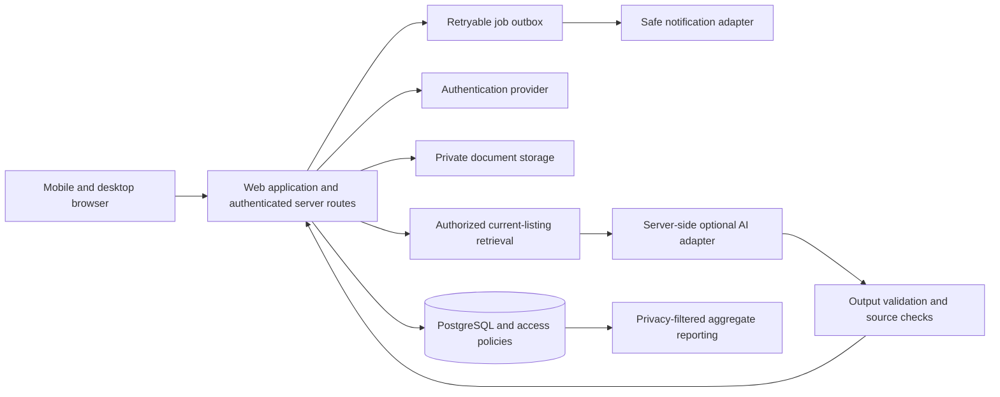

# System architecture — proposal P-04/P-05

Design specification only. No services are provisioned. Prefer a modular monolith for a small team; no initial microservices, vector database requirement or autonomous agent runtime.

## Proposed components and boundaries

Next.js/TypeScript frontend and server routes; Tailwind with accessible components; Supabase Auth/PostgreSQL/private Storage if approved. Exact versions and hosting to be evaluated in Sprint 0. Core domain modules: identity/authority, directory, partner verification, referrals/cases, consent, outcomes, reporting and safety. UI cannot independently decide authorization. Use a repository/service boundary so vendor-specific code is localized.

Browser contains only public configuration. AI keys and privileged database credentials stay server-side. User-scoped database requests should preserve database policy checks; do not use a privileged client for all requests. Narrow privileged jobs require explicit resource checks and audited service identity. Public directory data is a separate sanitized projection, never a view of case data with hidden UI columns.

## Referral transaction

Server validates actor/authority, current program/partner status, age gate, consent recipient/fields/purpose and allowed data. Write referral, initial case/event, consent reference and notification outbox atomically. Unique idempotency key avoids duplicate submissions. Send generic notification asynchronously with bounded retries and dead-letter review; delivery is not service receipt. Callback handlers verify signatures where integrations are later added.

## AI data path

First apply deterministic coverage, publication, verification, freshness and authorized data filters. Search the verified catalog using keyword/rules initially. Add semantic retrieval only if evaluation shows value. Send minimized query and authorized listing fields to the model. Validate returned IDs against the retrieved set; recheck activity at display and referral submission. No model write access to cases or external tools. Log safe metadata and feedback, not full vulnerable-user prompts by default.

## Global readiness, local operation

Use language tags, country and administrative region codes, UTC storage plus explicit display timezone, currency codes and original-language text. Separate country configuration for service coverage, policies, age gates, notification templates and operations contacts. Do not collect sensitive data from unsupported regions just because the interface loads there. Multi-country processing and region selection require privacy and contract review before launch.

## Operations and implementation evidence

Separate development/staging/production identities and data. Synthetic staging only. Monitor failed authorization, stale listings, referral latency, queue failures, AI fallback and costs using pseudonymous identifiers. Redact errors and analytics. Rate-limit anonymous search and auth; protect import tools from SSRF and malicious files. Define backup ownership and test restore; proposed RPO/RTO appear in PRD, not contractual promises. Fail AI safely into ordinary search; fail partner verification closed for new referrals. Keep rollback/feature flags for AI, minor access and external integrations.

Supabase implementation must verify current documentation, table grants plus row policies, storage rules and view behavior; no SQL is supplied as deployable security. See SOURCES.md and DATABASE_SCHEMA.md.
