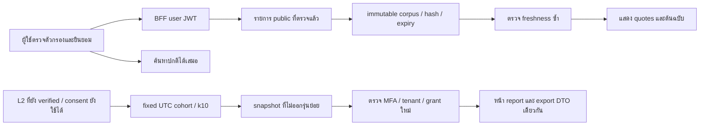

# ADR-007 — Navigator จากแหล่งสาธารณะและรายงานรวม

สถานะ: implementation ตามขอบเขตที่เจ้าของให้เลือกใน C-36; ไม่ใช่การอนุมัติ provider/vendor terms หรือ production S5

ใช้ stack/dependencies เดิม corpus มีเพียง approved public catalog revision พร้อม provenance immutable หนึ่ง bounded chunk ต่อภาษา ไม่จัดเก็บ transcript หรือ index เอกสารเคสส่วนตัว
คำค้นแปลงเป็นตัวกรองที่ตรวจ/แก้ได้และ opt-in ต่อการค้นหา raw query ไม่เข้าสู่ provider interface ซึ่งรับเฉพาะ public fields และไม่มี mutation tools โมเดลในอนาคตเลือกได้เพียง source IDs ที่ server ตรวจ ไม่แต่ง URL/quote/ข้อมูลติดต่อ

`goos_api` เป็นเจ้าของ public wrappers แบบ non-login/non-bypass ส่วน narrow operator-owned helpers ตรวจ user JWT/current authorization เองก่อนอ่าน public-source metadata หรือ aggregate ไม่มี arbitrary SQL และไม่ให้ client อ่าน private tables
`private.navigator_usage` เก็บ count/window เพื่อจำกัดการใช้ ไม่เก็บ query; ล้างหลัง1วันผ่าน worker เมื่อ S5 เปิด และลบตอน targeted purge
`private.impact_snapshot_members` เก็บ opaque subject IDs ภายในเพื่อ invalidate ไม่ส่งให้ viewer/export ไม่อ้างว่าเป็น anonymous storage

report ใช้เดือน UTC ที่ปิดแล้วและ metric version1 นับ distinct people จาก current independently verified L2; ตรวจ exact membership patterns ของประเภทและองค์กรเพื่อลด complementary inference
dispute/correction/withdrawal/purge ทำให้ fingerprint เปลี่ยนหรือ invalidate snapshot โดยตรง และไม่เปิดให้ caller ขอ date/person cuts หรือ metric รุ่นใหม่เพื่อเทียบส่วนต่าง
ไม่ใช่ differential privacy หรือ causal impact certification ต้องประเมิน auxiliary-information risk/recipient contracts ก่อน external CSR release

grant/report/source access ตรวจใหม่ทุก request; private revision signals ไม่มีข้อมูลเคสหรือ count browser revalidate เมื่อมีสัญญาณและใช้ polling fallback โดยล้างข้อมูลเมื่อสิทธิ์/เครือข่ายไม่ยืนยัน
S5 App/DB flags ปิด default; source-guidance ใช้งานได้โดยไม่มี external model/provider key และไม่ลดสิทธิ์ค้นหาปกติเมื่อไม่ opt-in

หลักฐาน tests/commands/ข้อจำกัดอยู่ [รายงาน S5](../S5_IMPLEMENTATION_TH.md) การทดสอบสังเคราะห์ไม่แทน human-labelled retrieval/safety หรือ hosted UAT

เมื่อข้อมูลทดสอบสะสม พบ RLS ของ note และ historical revision join ผ่าน parent RLS ซ้ำ จึงใช้ narrow boolean metadata helpers ตาม case/revision UUID และคง current work/progress/author/job visibility predicates พร้อม child/application candidate indexes ไม่เปิด payload หรือให้ client อ่าน private tables; ผล regression ดูรายงาน S5
